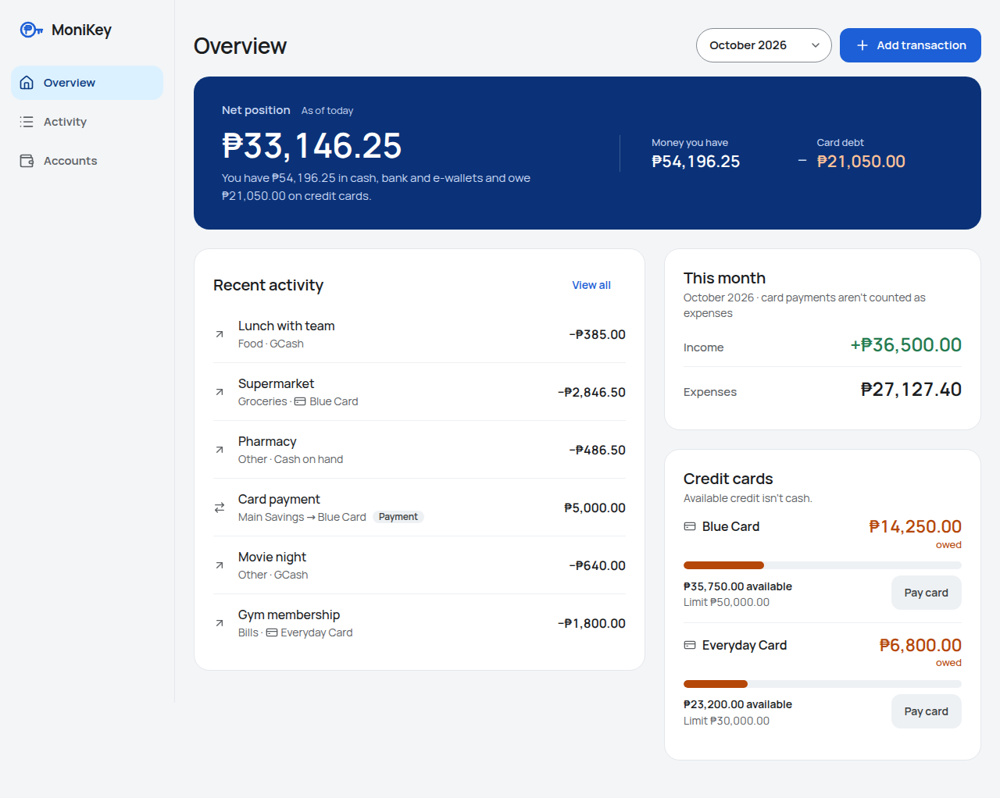
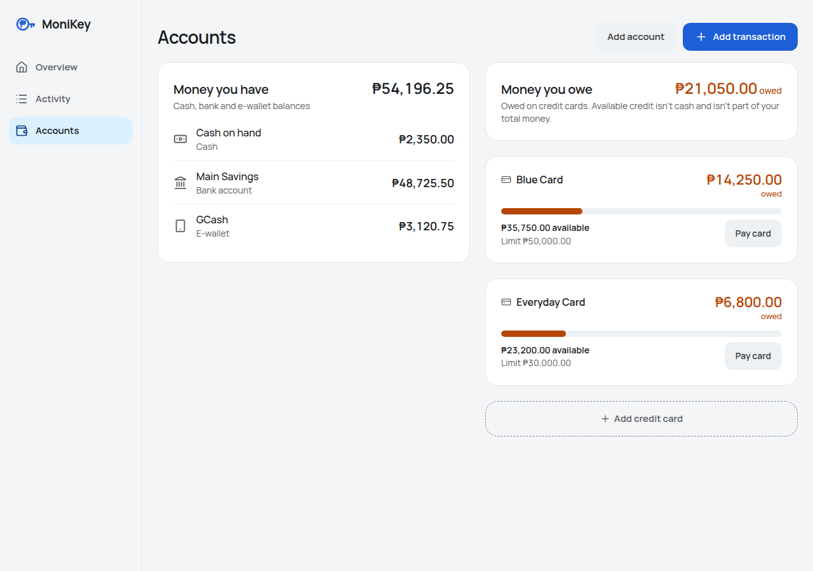
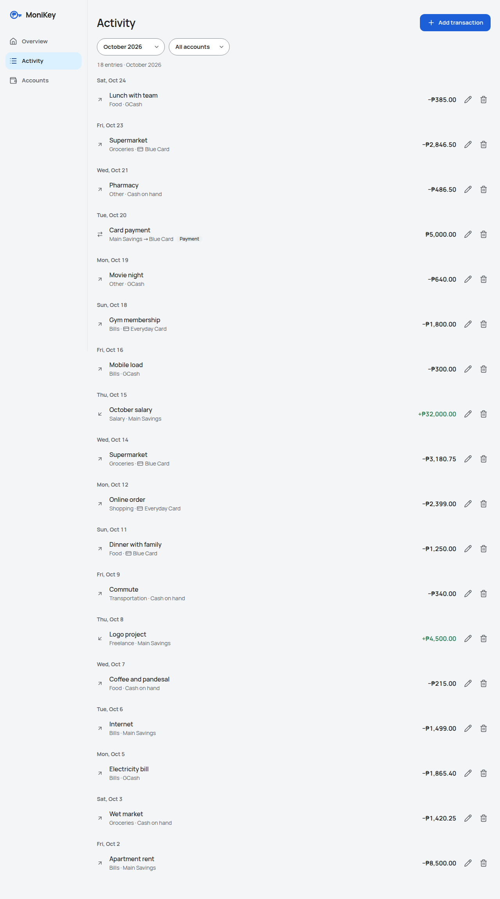

# MoniKey

MoniKey is a simple personal finance tracker for recording accounts, income, expenses, credit-card purchases and payments, and transfers between cash, bank, and e-wallet accounts. It is built as a beginner-friendly three-tier application and runs in a private homelab.

> **Privacy:** The deployed v1 has no authentication and accepts writes. It is restricted to a trusted private network and is not a public demo. Screenshots below use fictional mock data only.

## Screenshots

These existing design-review screenshots show the mock ledger, not the live homelab database. They were reused for this portfolio draft rather than recaptured from a running service.

### Overview



### Accounts



### Activity



## What it does

- Tracks cash, bank, e-wallet, and credit-card accounts.
- Records income and expenses with installation-wide categories that can be created, renamed, archived, restored, and safely deleted when unused.
- Uses four fixed Kakeibo envelopes (Needs, Wants, Culture, Unexpected); expense-category defaults suggest a classification for new entries, while each saved expense keeps its own choice.
- Supports monthly Kakeibo plans/reports and weekly reflections.
- Tracks card purchases as expenses and card payments separately, so a payment does not count as a second expense.
- Transfers money between liquid accounts without changing income or expense totals.
- Calculates balances, card debt, available credit, and monthly totals from the ledger.
- Lets the owner edit an account name, current balance/debt, and card limit while keeping its account type fixed.

For a short feature walkthrough and the system diagram, see [Portfolio overview](docs/portfolio/README.md).

## Architecture

- **Frontend:** React, TypeScript, Vite, Tailwind CSS v4, selected shadcn/ui components, and Lucide React.
- **API:** Python, FastAPI, REST endpoints, and parameterized SQL.
- **Database:** PostgreSQL with five ledger tables (`accounts`, `categories`, `transactions`, `credit_card_payments`, `account_transfers`) plus two Kakeibo planning/reflection tables.
- **Local development:** Docker Compose.
- **Delivery and deployment:** GitHub Actions builds and checks SHA-tagged images, GHCR stores them, and Argo CD deploys reviewed image updates from the separate `homelab-gitops` repository.

The detailed design and current milestone evidence are in [architecture docs](docs/architecture/README.md). Kubernetes manifests and the operational runbook live in the [homelab-gitops repository](https://github.com/Jeysibn/homelab-gitops).

## Run a mock preview

The frontend defaults to fictional in-memory data. This preview does not need the API or database:

```sh
cd frontend
npm ci
VITE_DATA_SOURCE=mock npm run dev
```

Open the local Vite URL shown in the terminal. To run the full local stack, use the root `docker-compose.yml` and follow the [backend README](backend/README.md) and [database guide](database/README.md). Do not point a portfolio preview at the private homelab database.

## Known limitations

- There is no login or authentication. Keep the writable deployment on a trusted private network; do not expose it publicly.
- The homelab deployment uses one Kubernetes node and one PostgreSQL replica. It is not highly available.
- The owner reports an automated database backup is configured in `homelab-gitops`. Off-cluster retention and recovery after node or storage failure have not been verified.
- TLS uses the homelab self-signed issuer, which may show a browser trust warning.
- The repository includes frontend unit tests and Playwright Chromium acceptance tests, including category and Quick Add journeys. These tests do not replace manual assistive-technology or real-device review.
- Banking integrations, recurring bills, and investments are out of scope for v1. Credit cards are not transfer destinations; use Pay card for those payments.

## Project status

As of 2026-11-10, `main` is `1f0408b5fcad91b19f2732e9ca50502b6c995ba1`. The owner reports the latest production release is on hold because of homelab internet connectivity. The latest GitOps desired manifest still points to MoniKey SHA `971322b…`; repository history does not establish the running image or live migration state. Do not assume custom categories or migration 007 are deployed. The app has no public writable demo. See the [learning guide](docs/LEARNING_GUIDE.md) for verified source and workflow details.

## Documentation

- [Documentation index](docs/README.md)
- [Start here: beginner learning guide](docs/LEARNING_GUIDE.md) — five stages from app basics to operations.
- [Architecture and roadmap](docs/architecture/README.md)
- [Feature walkthrough and architecture diagram](docs/portfolio/README.md)
- [Design and frontend status](docs/design/README.md)
- [Changelog and versions](CHANGELOG.md)
- [Backend setup](backend/README.md)
- [Database schema and checks](database/README.md)
- [GitOps deployment runbook](https://github.com/Jeysibn/homelab-gitops/blob/main/docs/MoniKey-Runbook.md)
