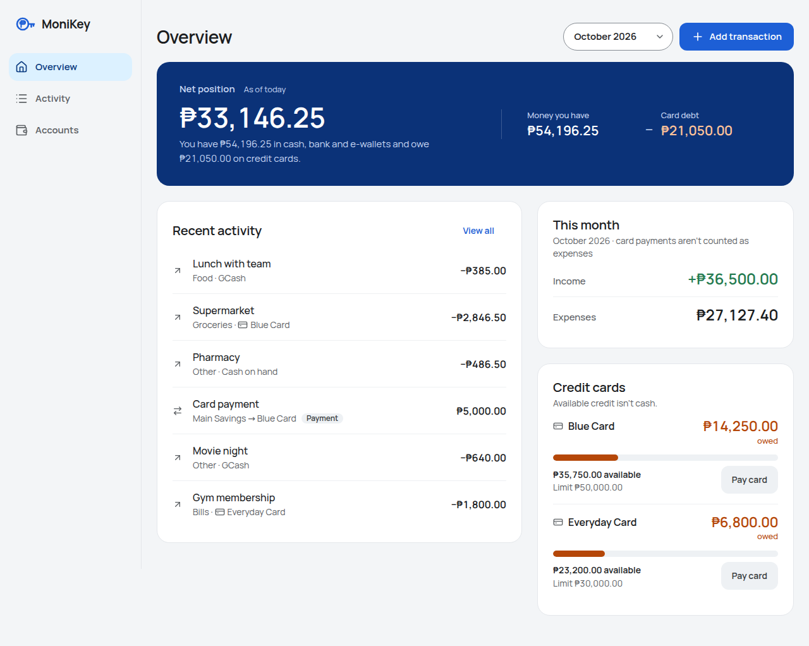
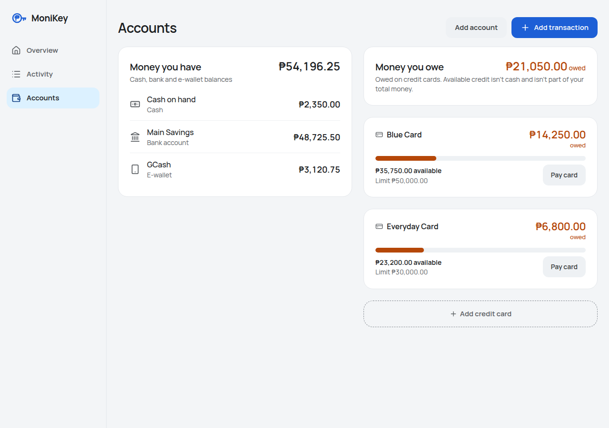
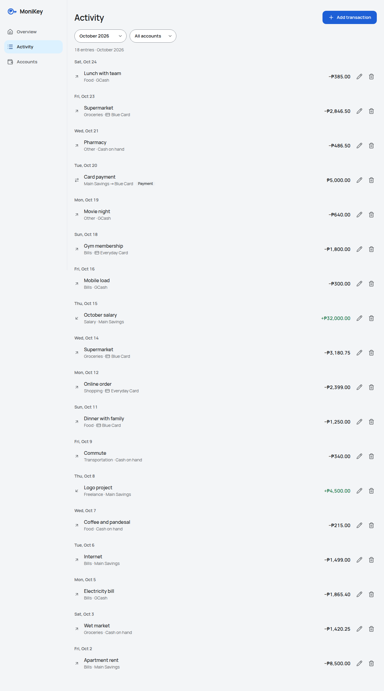

# MoniKey

MoniKey is a simple personal finance tracker for recording accounts, income, expenses, credit-card purchases, and card payments. It is built as a beginner-friendly three-tier application and runs in a private homelab.

> **Privacy:** The deployed v1 has no authentication and accepts writes. It is restricted to a trusted private network and is not a public demo. Screenshots below use fictional mock data only.

## Screenshots

These existing design-review screenshots show the mock ledger, not the live homelab database. They were reused for this portfolio draft rather than recaptured from a running service.

### Overview



### Accounts



### Activity



## What it does

- Tracks cash, bank, e-wallet, and credit-card accounts.
- Records income and expenses with categories and notes.
- Tracks card purchases as expenses and card payments separately, so a payment does not count as a second expense.
- Calculates balances, card debt, available credit, and monthly totals from the ledger.
- Lets the owner edit an account name, opening amounts, and card limit while keeping its account type fixed.

For a short feature walkthrough and the system diagram, see [Portfolio overview](docs/portfolio/README.md).

## Architecture

- **Frontend:** React, TypeScript, Vite, Tailwind CSS v4, selected shadcn/ui components, and Lucide React.
- **API:** Python, FastAPI, REST endpoints, and parameterized SQL.
- **Database:** PostgreSQL with four core tables: `accounts`, `categories`, `transactions`, and `credit_card_payments`.
- **Local development:** Docker Compose.
- **Delivery and deployment:** GitHub Actions builds and checks SHA-tagged images, GHCR stores them, and Argo CD deploys reviewed image updates from the separate `homelab-gitops` repository.

The detailed design and current milestone evidence are in [architecture docs](docs/architecture/README.md). Kubernetes manifests and the operational runbook live in the [homelab-gitops repository](https://github.com/Jeysibn/homelab-gitops).

## Run a mock preview

The frontend defaults to fictional in-memory data. This preview does not need the API or database:

```sh
cd frontend
npm ci
VITE_DATA_SOURCE=mock npm run dev
```

Open the local Vite URL shown in the terminal. To run the full local stack, use the root `docker-compose.yml` and follow the [backend README](backend/README.md) and [database guide](database/README.md). Do not point a portfolio preview at the private homelab database.

## Known limitations

- There is no login or authentication. Keep the writable deployment on a trusted private network; do not expose it publicly.
- The homelab deployment uses one Kubernetes node and one PostgreSQL replica. It is not highly available.
- Backups are manual logical dumps. Scheduled off-cluster retention and recovery after node or storage failure have not been verified.
- TLS uses the homelab self-signed issuer, which may show a browser trust warning.
- API routes were exercised with synthetic data, but the full interactive React/API browser journey remains unverified. Automated browser, physical-device, and screen-reader checks are also outstanding.
- Banking integrations, recurring bills, investments, and regular transfers are out of scope for v1.

## Project status

Milestones 11–12 are complete: the private homelab deployment is healthy, and this README plus the portfolio page document the app using fictional sample data. The deployment, storage, HTTPS ingress, database restore, and image rollback checks are in the [roadmap](docs/architecture/ROADMAP.md) and [GitOps runbook](https://github.com/Jeysibn/homelab-gitops/blob/main/docs/MoniKey-Runbook.md). No public writable demo is provided.

## Documentation

- [Architecture and roadmap](docs/architecture/README.md)
- [Feature walkthrough and architecture diagram](docs/portfolio/README.md)
- [Design and frontend status](docs/design/README.md)
- [Backend setup](backend/README.md)
- [Database schema and checks](database/README.md)
- [GitOps deployment runbook](https://github.com/Jeysibn/homelab-gitops/blob/main/docs/MoniKey-Runbook.md)
