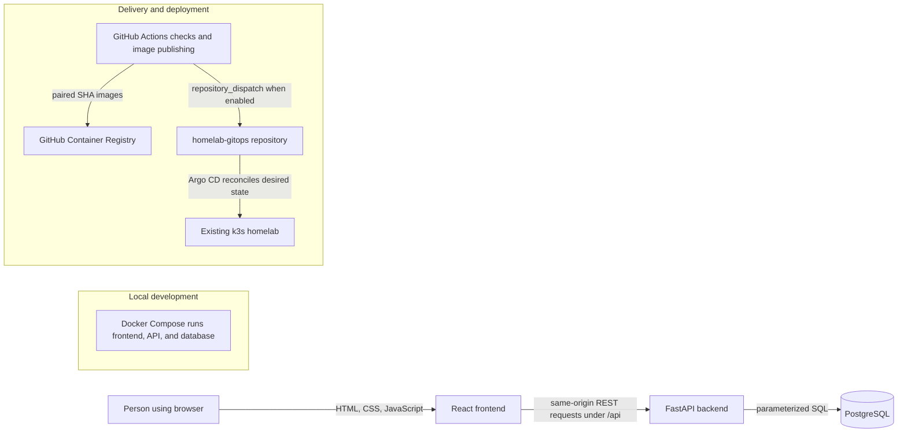

# Learn MoniKey

This guide follows the code that exists in MoniKey `main` at commit
[`1f0408b`](https://github.com/Jeysibn/monikey/commit/1f0408b5fcad91b19f2732e9ca50502b6c995ba1).
It is an entry point for learning the application, not a claim that this commit
has been deployed.

## Stage 1: Understand the application

MoniKey is a private personal-finance tracker. It records accounts, income,
expenses, credit-card purchases and payments, and transfers between liquid
accounts. It also provides monthly Kakeibo budgeting and category management.
It is designed for one trusted installation: v1 has no login and no user table,
so every category and account belongs to the installation, not to a signed-in
person. Keep any writable instance on a trusted private network.

Three-tier means three main responsibilities:

1. The **frontend** displays screens and collects input in a browser.
2. The **backend API** validates requests and applies the financial rules.
3. The **database** stores the ledger and Kakeibo planning data.

The browser never connects directly to PostgreSQL.

## Stage 2: Understand the architecture

The entry point is `frontend/src/main.tsx`. It creates the React app, whose
navigation and shared screen state live in `frontend/src/App.tsx`. The app
selects an in-memory mock source or the real HTTP source through the
`DataSource` interface.



The first three arrows are the application's request path. The delivery path
is separate: GitHub Actions builds images and the GitOps repository records
which image pair should run. This diagram describes repository configuration;
it does not prove the current cluster state.

### Frontend data flow

`frontend/src/App.tsx` owns a small amount of presentation state: selected
screen, month, active dialog and refresh counters. There is no router or global
state library. Screens such as `OverviewView`, `ActivityView`, `AccountsView`,
`KakeiboView`, and `CategoriesView` receive data and callbacks as props.

`frontend/src/dataSource.ts` defines the data operations screens use.
`frontend/src/httpSource.ts` implements them with same-origin `fetch('/api/...')`
requests. `frontend/src/mockSource.ts` supplies fictional in-memory data for
previews and tests. `frontend/src/wire.ts` checks API response shapes and maps
them into frontend types. `useResource.ts` provides loading, error and retry
state. After a successful write, the app reloads server data rather than
trusting a browser-side balance calculation.

### Backend request path

FastAPI is created in `backend/main.py`; database connection and transaction
handling are in `backend/database.py`. For example, a request reaches a
`@app.post(...)` route, Pydantic parses and validates its JSON, the route checks
related records, executes parameterized SQL inside `open_connection()`, and
returns a JSON response. FastAPI turns known validation or application errors
into HTTP responses. The project uses Psycopg 3 and direct SQL; it does not use
an ORM or a separate service framework.

## Follow one ₱500 grocery expense

1. The person opens Quick Add. `frontend/src/components/TransactionForm.tsx`
   collects an amount, account, category, date and optional note.
2. `frontend/src/lib/entryForm.ts` validates the form. If the category has a
   default envelope, the form suggests it. Choosing another envelope records
   the person's override.
3. `frontend/src/App.tsx` calls the selected data source. In the real app,
   `frontend/src/httpSource.ts` sends a `POST /api/transactions` request with
   `account_id`, `category_id`, decimal-string `amount`, `transaction_date`,
   `note`, and nullable `kakeibo_envelope` fields.
4. `backend/main.py` parses `TransactionInput`, checks that the account and
   category exist, validates the envelope/category/account combination under
   the backend's rules, and inserts the row into `transactions`. The form also
   requires an expense category for an expense entry.
5. PostgreSQL stores the expense and its chosen envelope. Account positions,
   monthly totals and Kakeibo reports are derived from the ledger; the browser
   does not write a separate balance. The server returns the stored record.
6. The frontend reloads the affected data and displays the updated result.
   A credit-card purchase is still an expense and increases card debt. Paying
   that card is a separate `credit_card_payments` record, not another expense.

Actual handlers include `create_transaction()` at `POST /api/transactions`,
`account_positions_sql()` for account positions, and `kakeibo_actuals()` for
monthly envelope totals in `backend/main.py`. The API contract is summarized
in [`docs/architecture/TLD.md`](architecture/TLD.md).

## Custom categories and Kakeibo

Income and expense categories are rows in the existing `categories` table.
Transactions refer to a stable category ID; they do not copy the category name.
Since the app has no authentication, categories are shared across this private
installation. A category's income/expense type cannot be changed later.

A category can be renamed without changing transaction amounts or IDs. An
expense category may have a **default Kakeibo envelope**, which is a suggestion
for a new expense. The selected envelope is stored on that particular
transaction, so changing a default does not reclassify old expenses. The four
fixed envelopes are **Needs**, **Wants**, **Culture**, and **Unexpected**.
Income categories do not use envelopes.

Archiving hides a category from new transaction choices but preserves the
category ID and historical display. A transaction already using an archived
category can still be read and edited while retaining that reference. Restore
makes the category selectable again. Permanent deletion is allowed only when
no transaction refers to the category; the API checks references and the
foreign key provides a final database guard.

The category screen is implemented in
`frontend/src/views/CategoriesView.tsx`; API handlers are grouped near the end
of `backend/main.py` (`GET/POST/PATCH/DELETE /api/categories`). Migration 007
adds archive and integrity protections without rewriting the ledger.

## PostgreSQL, tables, and migrations

PostgreSQL is the relational database. A **table** stores rows of one kind;
a **foreign key** connects a row to a related row and prevents references to
missing records. MoniKey's five ledger tables are:

| Table | What it stores |
|---|---|
| `accounts` | Cash, bank, e-wallet, and credit-card account baselines and settings |
| `categories` | Installation-wide income and expense categories and envelope defaults |
| `transactions` | Income and expense entries, including card purchases and chosen Kakeibo envelope |
| `credit_card_payments` | Payments that reduce both the paying account and card debt without adding expense |
| `account_transfers` | Moves between liquid accounts without changing income or expense totals |

Kakeibo adds two metadata tables for monthly plans/reviews and weekly
reflections. These are separate from the five ledger tables. Monetary columns
use PostgreSQL `NUMERIC(12,2)`; JSON money values are decimal strings.

A **migration** is a numbered SQL change to a database's structure or rules.
The number makes the intended order explicit. Migration files `001`–`008` are
in `database/`. The database migration runner in `database/migrate.py` records
checksums, serializes runners with a PostgreSQL advisory lock, recognizes known
starting schemas, and fails closed on incomplete or unknown states. The API
does not silently apply migrations at startup.

Migration 007 adds `categories.is_archived`, name checks and normalized
case-insensitive uniqueness, a trigger that prevents changing category type,
and a trigger that prevents new transactions from using archived categories.
It preserves existing category IDs, transaction rows, amounts, and saved
classifications. The database guide explains the synthetic migration tests
and the backup/recovery rehearsal: [`database/README.md`](../database/README.md).
For an existing live database, follow the GitOps backup and migration gates;
never run a production migration as a local learning exercise.

Migration 008 adds an optional category icon key from a small allowlisted Lucide
collection. Existing rows remain unset, and changing an icon does not change
transaction history. Source support does not mean the migration has been
applied to production.

## Stage 3: Develop and test locally

### Mock-only preview

This is the simplest safe way to explore the interface. It uses fictional
in-memory data and does not need a database:

```sh
cd frontend
npm ci
VITE_DATA_SOURCE=mock npm run dev
```

Use the local URL Vite prints. Stop it with Ctrl+C.

### Full local stack

From the repository root, copy `.env.example` to `.env`, replace the
placeholder with a local-only password, then run:

```sh
docker compose up --build
```

Open `http://127.0.0.1:8080`. Compose starts PostgreSQL, the FastAPI API, and
Nginx serving the built React files. Only the frontend port is published to
loopback. The named database volume persists across `docker compose down`; do
not use `down --volumes` if you need to keep local data.

### Test commands

Run from the repository root unless noted:

| Command | What it checks | Safe use and common needs |
|---|---|---|
| `cd frontend && npm ci` | Installs the exact frontend dependencies in the lockfile | Local; requires Node 22 and network/package access |
| `cd frontend && npm run lint` | Static frontend lint checks | Local; reports code-style and common issue diagnostics |
| `cd frontend && npm test` | Node test-runner checks for frontend helpers, accounting rules, API mapping and requests | Local; no live database required |
| `cd frontend && npm run build` | TypeScript project checks and Vite production bundle | Local; a TypeScript error stops the build |
| `bash database/test.sh` | SQL constraints, financial invariants, migrations and migration-runner helpers in a disposable PostgreSQL container | Local; Docker must be running; uses synthetic data |
| `bash backend/test.sh` | FastAPI tests against disposable PostgreSQL after applying migrations and seed | Local; first create `backend/.venv` and install `backend/requirements-dev.txt`; Docker must be running |
| `cd frontend && npm run test:browser` | Playwright Chromium browser acceptance | Local only; requires the isolated Compose QA stack from [`frontend/browser-tests/README.md`](../frontend/browser-tests/README.md) and installed Chromium; does not run deployments |
| `bash database/rehearse_recovery.sh` | Creates a synthetic backup, restores it separately, applies migrations to a restored copy, and checks data invariants/API reads | Local; Docker and the backend virtual environment are required; never points to production |

A passing unit test protects a small rule. An API test protects request
validation and database behavior. A browser test protects how a person
completes a flow through the rendered interface. None of these by itself proves
a successful production deployment.

## Stage 4: Deliver changes with Git, GitHub, and GitOps

A **branch** is an isolated line of changes. A **pull request (PR)** asks
reviewers to check those changes before they become part of `main`.

1. Pull requests run `.github/workflows/ci.yml`: frontend lint/tests/build,
   artwork validation, database and API tests, and frontend/API container build
   checks. A pull request does not publish production images because the
   `publish` job is restricted to a push to `main`.
2. After an approved merge, a push to `main` runs CI again. If the checks pass,
   CI publishes paired frontend and API images to GHCR. Each image uses
   `sha-<full Git commit SHA>`, which identifies the exact source revision.
3. `.github/workflows/deploy.yml` accepts only successful CI for a push to
   MoniKey's own `main`, verifies both images, and requests a
   `repository_dispatch` event named `monikey-release` in `homelab-gitops` when
   `HOMELAB_GITOPS_DISPATCH_TOKEN` is configured. Otherwise it intentionally
   records that dispatch was skipped. GitOps also supports owner-triggered
   `workflow_dispatch` releases; initial schema adoption is an optional gated
   mode.
4. GitOps verifies source-run and image provenance, then its release workflow
   requires a PostgreSQL backup and a successful restore into disposable
   PostgreSQL before image promotion. It opens a GitOps pull request rather
   than editing protected desired state directly.
5. After GitOps checks and its configured promotion gate pass, Argo CD
   reconciles the reviewed image SHA into the existing k3s cluster. The release
   workflow checks Argo CD sync/health and API readiness, then handles its
   migration gate reset. See the [GitOps runbook](https://github.com/Jeysibn/homelab-gitops/blob/main/docs/MoniKey-Runbook.md)
   for operator detail.

The MoniKey repo defines build and dispatch requests. The GitOps repo defines
Kubernetes desired state and release operations. A successful MoniKey CI or
dispatch request is not proof that GitOps received the event or that the
cluster deployed it.

### Current release and deployment status

As of 2026-11-10, application version metadata remains `1.2.0`; the newest Git
tag is `v1.2.0`; there is no GitHub Release object. Later features are recorded
as unreleased in the changelog. MoniKey main CI for `1f0408b` succeeded and its
Deploy workflow completed a dispatch request, but the GitOps desired manifest
still names the previous MoniKey image SHA `971322b…`. The owner reports the
production release is on hold because of homelab internet connectivity. No
repository evidence establishes the currently running cluster image or live
database migration state. Do not assume migration 007 or the latest feature
code is deployed.

### Version words in plain English

| Term | Meaning in MoniKey |
|---|---|
| Application version | Human-facing compatibility/release number; currently `1.2.0` in `frontend/package.json` and FastAPI metadata in `backend/main.py` |
| Semantic Versioning | `MAJOR.MINOR.PATCH`: breaking change, compatible feature, or compatible bug fix, respectively. This is the changelog's stated policy, not proof that every merge bumps the number |
| Git commit SHA | Unique identifier of one source snapshot, such as `1f0408b…` |
| Git tag | Named pointer to a chosen commit, such as `v1.2.0`; the current tag points to `353cf8a…`, not latest `main` |
| GitHub Release | GitHub's release-page metadata and optional downloadable files; no release objects currently exist |
| Container image tag | Registry label for a built image; MoniKey uses immutable full-SHA tags to pair frontend and API images |
| Migration number | Ordering for database changes, e.g. `007`; it is not the app version |
| Changelog entry | Human-readable summary of notable code changes; an Unreleased item is not a release |
| Deployed version | The image/schema actually running in the cluster; it must be verified from GitOps/runtime evidence and is currently unverified for latest `main` |

## Stage 5: Operate and troubleshoot safely

Start with repository-local information and safe checks. Do not run cluster or
production database commands just to learn how the system works.

| Symptom | Safe first checks |
|---|---|
| Frontend does not load | Check Vite output for a mock preview or `docker compose ps` for the local stack; check the browser console for local errors |
| API connection fails | Confirm the local backend is listening on port 8000 and frontend uses same-origin `/api`; try `/api/health/ready` on the local development server |
| Database connection error | Check local Compose database health and `DATABASE_URL`; do not paste passwords into logs or commit `.env` |
| Migration test fails | Read the first SQL error and the migration runner output; rerun only against its disposable test database after understanding the failure |
| Frontend/backend tests fail | Run the failing suite alone, read the assertion and traceback, and check the relevant source and fixture; do not edit financial expectations just to make tests pass |
| GitHub Actions fails | Open the failed step in the workflow run; pull-request CI does not publish images, while `main` image publication is release-sensitive |
| Container build fails | Check Docker output and the corresponding Dockerfile; local build is safe but does not deploy |
| GitOps sync does not finish | Read the GitOps workflow summary and Argo CD health evidence; do not manually force sync or alter migration gates without owner authorization |
| Homelab cannot reach the internet | Treat deployment as unavailable/held. Do not infer that source, image, or database schema is deployed; wait for connectivity and owner-controlled release verification |

## Learning path

1. **Understand MoniKey:** this page's [Stage 1](#stage-1-understand-the-application) and [README](../README.md).
2. **Understand the architecture:** [Stage 2](#stage-2-understand-the-architecture), the [TLD](architecture/TLD.md), and [ADRs](architecture/ADR.md).
3. **Understand development:** [Stage 3](#stage-3-develop-and-test-locally), [frontend guide](../frontend/README.md), [backend guide](../backend/README.md), and [database guide](../database/README.md).
4. **Understand delivery:** [Stage 4](#stage-4-deliver-changes-with-git-github-and-gitops), [changelog](../CHANGELOG.md), and the [deployment runbook](https://github.com/Jeysibn/homelab-gitops/blob/main/docs/MoniKey-Runbook.md).
5. **Understand operations:** [Stage 5](#stage-5-operate-and-troubleshoot-safely), [roadmap](architecture/ROADMAP.md), and the runbook's backup, recovery, health and rollback sections.

## Glossary

- **API:** a defined way for one program to ask another program for data or an action.
- **CI (continuous integration):** automated checks run on proposed or merged source changes.
- **CD (continuous delivery/deployment):** automation that prepares or applies a release.
- **GHCR:** GitHub Container Registry, where MoniKey stores built container images.
- **GitOps:** keeping the desired deployment configuration in Git and having a controller compare it with the running system.
- **Argo CD:** the GitOps controller that reconciles Kubernetes resources from the GitOps repository.
- **k3s:** a lightweight Kubernetes distribution used by the existing homelab.
- **Kubernetes:** a system that runs and monitors containers according to desired configuration.
- **Foreign key:** a database rule that requires a referenced row to exist.
- **Parameterized SQL:** a query where user values are passed separately from SQL text, reducing injection risk and making types explicit.
- **Idempotent:** safe to repeat without applying the same effect twice.
