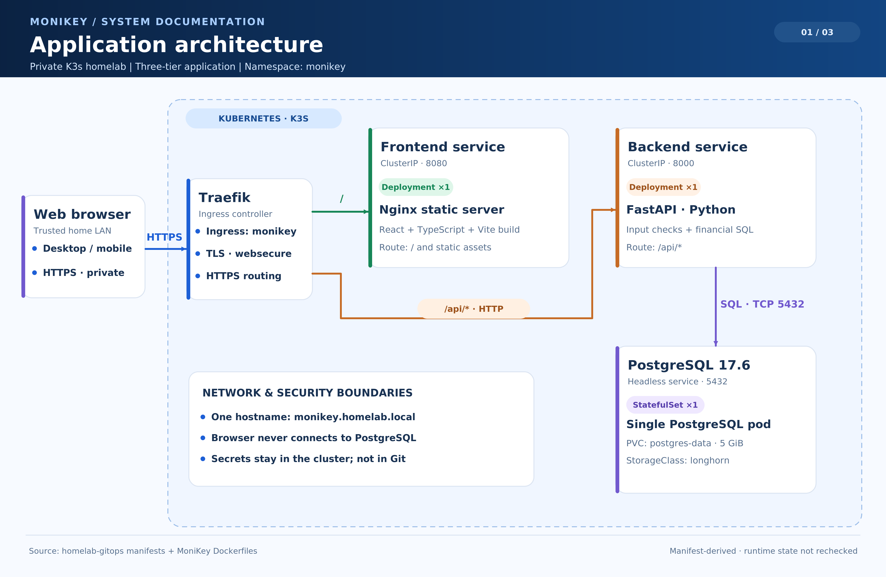
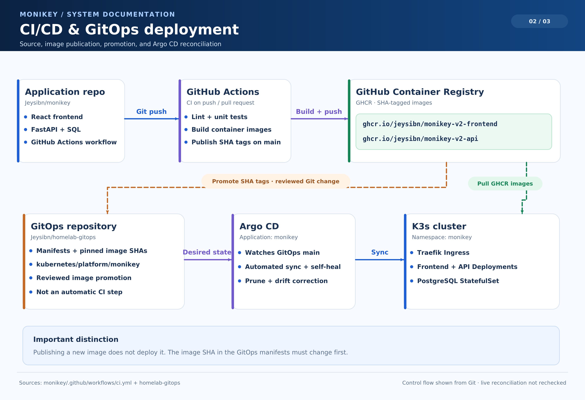
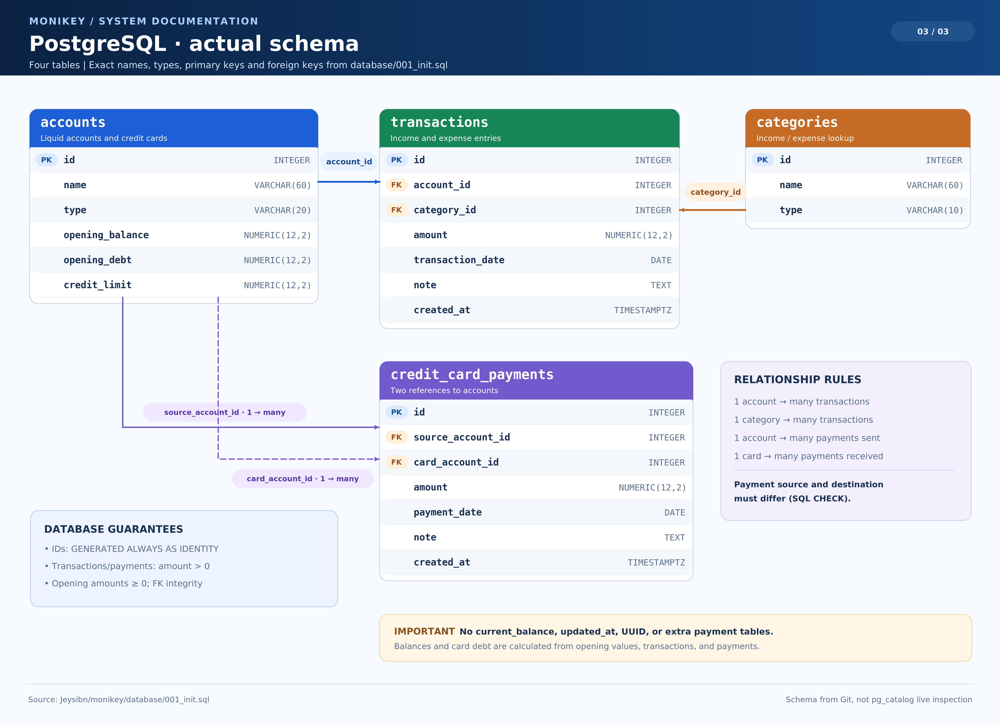

# Architecture documents

The architecture baseline originated in `MoniKey_v1_3_Architecture_with_Obsidian.zip` (SHA-256 `93da7ad300992e2933970ba208a7748f06a4110533842f970e5932130801f730`) and is maintained in this repository. The approved design describes the target application. The current implementation includes the mock-backed frontend, contract-driven HTTP client, PostgreSQL schema and accounting checks, FastAPI endpoints, Compose stack, CI/GHCR delivery, and private Kubernetes deployment. See the [roadmap](ROADMAP.md#current-progress-and-next-gate) for evidence and remaining checks.

Use [ROADMAP.md](ROADMAP.md#current-progress-and-next-gate) for the current progress snapshot. Treat milestone reports as dated evidence for their own scope; they may predate later integration and deployment work.

## Architecture diagrams

The PNG files are convenient previews; each SVG is the matching scalable version.

### Application architecture

Shows the private browser-to-ingress path, frontend, API, PostgreSQL, and the deployed security boundary. Deployment values are derived from the GitOps manifests and application configuration; live cluster state is not rechecked by the diagram.

[Open scalable SVG](01-monikey-application.svg)

### CI/CD and GitOps deployment

Shows image checks and publication, the reviewed image promotion in the separate GitOps repository, and Argo CD reconciliation.

[Open scalable SVG](02-monikey-gitops.svg)

### Database schema

Shows the four PostgreSQL tables and their foreign-key relationships. The source of truth is [`database/001_init.sql`](../../database/001_init.sql).

[Open scalable SVG](03-monikey-database-erd.svg)

- [TLD](TLD.md)
- [ADRs](ADR.md)
- [Master Plan](MASTER_PLAN.md)
- [Roadmap](ROADMAP.md)
- [AI Agent Playbook](AI_AGENT_PLAYBOOK.md)
- [Frontend setup checklist](FRONTEND_SETUP.md)
- [Obsidian guide](OBSIDIAN_GUIDE.md)

The application repository remains authoritative for application code and accepted architecture. The separate existing `homelab-gitops` repository remains authoritative for Kubernetes desired state.
