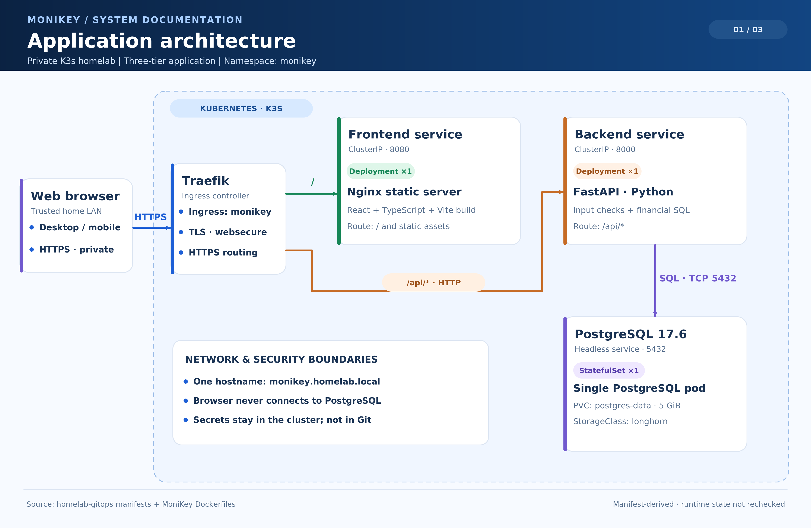
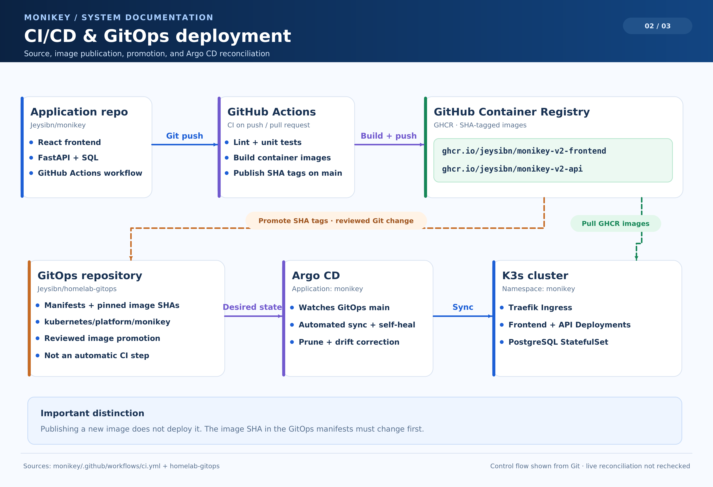
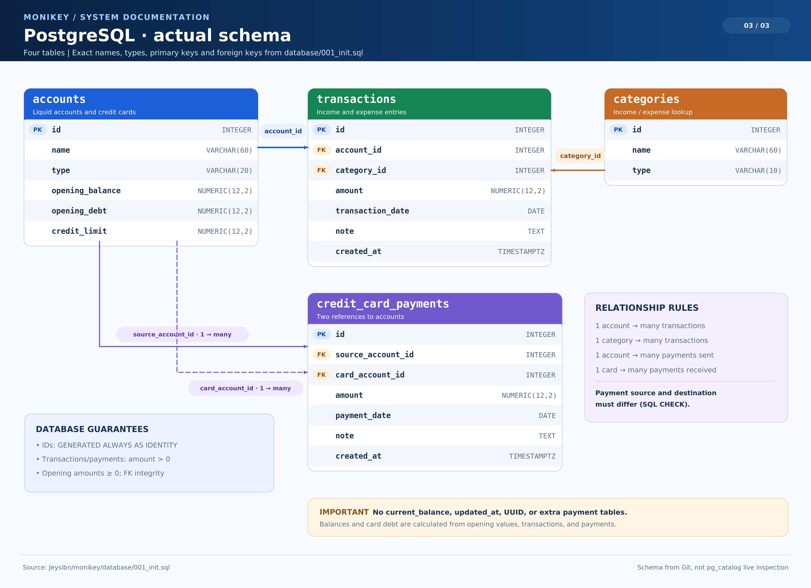

# Architecture documents

The v1 design history is retained here, but the source code and current accepted ADRs describe the implementation that exists. The current application has React screens for Overview, Activity, Accounts, Categories, and Kakeibo; a FastAPI API; PostgreSQL ledger and planning tables; and Compose, GitHub Actions, GHCR, and GitOps delivery configuration. See the [learning guide](../LEARNING_GUIDE.md) for a beginner walkthrough and [ROADMAP.md](ROADMAP.md#current-source-and-release-status) for dated source/deployment evidence.

Milestone reports are historical records. Their old “not built,” “awaiting review,” or deployment status applies only to the date and scope in that report; it is not current status evidence.

## Architecture diagrams

The PNG files are convenient previews; each SVG is the matching scalable version.

### Application architecture

Shows the private browser-to-ingress path, frontend, API, PostgreSQL, and the deployed security boundary. Deployment values are derived from the GitOps manifests and application configuration; live cluster state is not rechecked by the diagram.

[Open scalable SVG](01-monikey-application.svg)

### CI/CD and GitOps deployment

Shows image checks and publication, the reviewed image promotion in the separate GitOps repository, and Argo CD reconciliation.

[Open scalable SVG](02-monikey-gitops.svg)

### Database schema

This ER image is an early schema snapshot and is no longer complete: the source now has five financial tables and two Kakeibo metadata tables, plus category lifecycle fields. Use [`database/README.md`](../../database/README.md) and [`database/001_init.sql`](../../database/001_init.sql) through migrations 007 as the current references. The historical image is retained to preserve the design record.

[Open scalable SVG](03-monikey-database-erd.svg)

- [TLD](TLD.md)
- [ADRs](ADR.md)
- [Master Plan](MASTER_PLAN.md)
- [Roadmap](ROADMAP.md)
- [AI Agent Playbook](AI_AGENT_PLAYBOOK.md)
- [Frontend setup checklist](FRONTEND_SETUP.md)
- [Obsidian guide](OBSIDIAN_GUIDE.md)

The application repository remains authoritative for application code and accepted architecture. The separate existing `homelab-gitops` repository remains authoritative for Kubernetes desired state.
