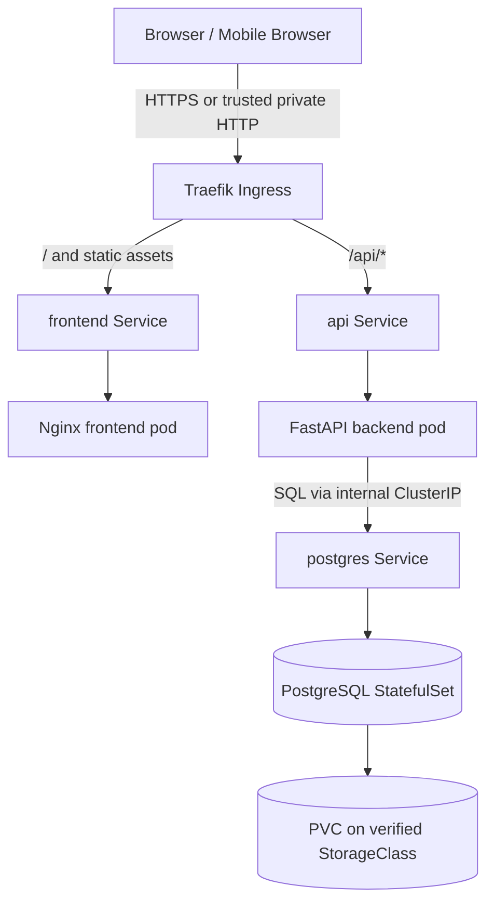
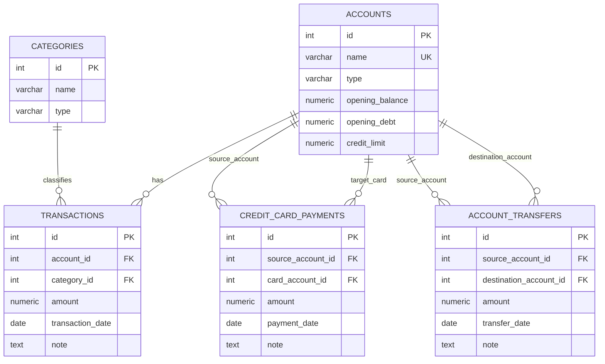
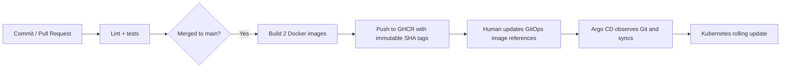

# MoniKey v1 — Technical-Level Design (TLD)

**Version:** 1.3 (v1.2 stack retained; Obsidian second-brain workflow added)  
**Date:** 2026-10-24  
**Status:** Requirements and technical direction agreed. The M5 mock UI was approved; M6–7 and M9–13 are implemented, including the private Kubernetes deployment through `homelab-gitops`. M13 transfers and migration 002 are deployed; the owner confirms transfers are working properly. M8 API routes were exercised, but the full React/API browser journey and owner acceptance remain pending. M9 local Compose behavior and M11 health, persistence, ingress, logical restore, and image rollback were checked; see [ROADMAP.md](ROADMAP.md#current-progress-and-next-gate) and the [GitOps deployment runbook](https://github.com/Jeysibn/homelab-gitops/blob/main/docs/MoniKey-Runbook.md) for current evidence and limits. This design does not claim off-cluster backup recovery or public deployment readiness.
**Related:** [MASTER_PLAN.md](MASTER_PLAN.md) · [ADR.md](ADR.md) · [AI_AGENT_PLAYBOOK.md](AI_AGENT_PLAYBOOK.md) · [ROADMAP.md](ROADMAP.md) · [OBSIDIAN_GUIDE.md](OBSIDIAN_GUIDE.md) · [AGENTS.md](AGENTS.md)

## 1. Purpose and success criteria

MoniKey is a **beginner-friendly, portfolio-worthy three-tier personal finance tracker**, built frontend-first and deployed to the existing single-node/home Kubernetes GitOps environment after local testing.

A successful v1 allows one user to:
- Create Cash, Bank, and E-wallet accounts with opening balances and edit their current balances (ADR-018); transfer money between distinct liquid accounts.
- Create credit-card accounts with a credit limit and opening debt; edit their current signed debt and credit limit (ADR-018). Account type cannot be changed after creation.
- Record, view, edit, and delete categorized income and expense transactions.
- Record, view, edit, and delete credit-card payments from non-credit-card accounts.
- See current liquid balances, credit-card debt, available credit, net tracked position, and monthly income/expense summaries.
- Retain records after API/DB/container/pod restarts, and recover from a tested backup.
- Explain frontend-to-API-to-database requests and code-to-cluster GitOps delivery in an interview.

**Explicitly out of scope:** authentication, multi-user accounts, bank sync, transfers to or from credit cards (use the separate card-payment flow), budgets, recurring bills, statement cycles, card interest, installment tracking, rewards, investments, notifications, production-grade high availability, and complex analytics.

## 2. Assumptions and boundaries

- **Frontend:** React functional components + TypeScript + Vite + **Tailwind CSS v4**, selected **shadcn/ui** component source files and **Lucide React** icons, initially backed by typed mock data. Production static assets from Vite `dist/` are served by Nginx; no Node or Vite server runs in production.
- **Backend:** Python + FastAPI + Pydantic + a PostgreSQL driver (e.g. psycopg); direct readable SQL rather than an ORM.
- **Database:** one PostgreSQL instance; five core tables; money represented by PostgreSQL `NUMERIC(12,2)` and JSON decimal strings.
- **Local:** Docker Compose for frontend, API, and DB.
- **Cluster:** existing k3s/Kubernetes, Traefik ingress, Argo CD, and an operational StorageClass (Longhorn *if verified*). No new cluster is needed.
- **Source layout:** new MoniKey v1 application repository; separate existing `homelab-gitops` repository for Kubernetes manifests.
- **Security:** v1 has **no authentication**. Deploy behind a private/trusted network only (e.g. Tailscale). Never publicly expose a writable financial-data API without adding proper authentication/authorization.
- **Time zone:** input transaction dates are calendar dates (`YYYY-MM-DD`, interpreted using `Asia/Manila` UX defaults); audit timestamps use timezone-aware UTC in PostgreSQL.
- **Knowledge management:** Personal project learning, troubleshooting, and progress notes live in a separate local Obsidian vault; the Git repositories remain authoritative for implementation and accepted architecture. The vault is not an application tier and is never deployed.
- These are target decisions, not claims about currently deployed state.

## 3. Architecture and network routing



**One origin, two routes:** The browser loads `/` and Vite-generated hashed JS/CSS assets (`/assets/*`) from the frontend. The React API client calls relative paths such as `/api/accounts` and `/api/summary?month=2026-10`; Traefik directs those to the API Service. FastAPI itself owns routes prefixed `/api`, so **no fragile ingress path rewrite** is needed. API documentation is served at `/api/docs` on the private network if enabled.

**Local parity:** During UI work, Vite serves the development frontend at `http://localhost:5173` with a `/api` proxy to `http://localhost:8000` (or the Compose backend). In production-like Compose, Nginx serves `dist/` and proxies `/api` to `backend:8000`; in Kubernetes, Traefik routes `/api` directly to the API Service. The React API client always uses relative `/api/*` URLs. The browser **never connects directly to PostgreSQL** and does not contain DB credentials.

### Components

| Component | Responsibility | Runtime | External exposure |
|---|---|---|---|
| Frontend | React views/forms, Tailwind utilities, selected shadcn/ui primitives, Lucide icons, typed fetch requests | Vite compiles JSX/TS and Tailwind CSS into static assets; Nginx serves `dist/` | Via trusted ingress only |
| Backend | Input validation, domain rules, balance calculations, SQL transactions | FastAPI and PostgreSQL driver | `/api` via trusted ingress |
| Database | Durable account, category, transaction, payment records | PostgreSQL with persistent volume | Internal ClusterIP only |
| GitHub Actions | Tests, build/version container images, push GHCR | GitHub hosted runner | No K8s credentials needed |
| Argo CD | Reconcile Kubernetes desired state committed to Git | Existing cluster | Existing Argo CD access only |

## 4. React application structure, navigation and data loading

**Navigation:** Three React views (`Overview`, `Activity`, `Accounts`) plus a reusable `QuickAddForm` overlay/sheet. `App.tsx` holds a simple selected-view state. No React Router in v1: views are tabs of a single application at `/` with no required deep links. Use semantic navigation buttons and accessible focus handling. The design must support mobile-first layout.

**Styling responsibilities:** Tailwind CSS v4 utility classes handle layout, spacing, typography and responsive behavior. A single `src/index.css` entry imports `tailwindcss` and stores the small theme/token set managed by shadcn's initializer and the approved `DESIGN.md`. **shadcn/ui is a collection of copied React component source files, not a hosted service or a second application tier.** Only add `button`, `card`, `input`, `label` and `dialog` initially; use native `<select>` for straightforward account/category dropdowns. Import Lucide icons **by name** from `lucide-react`; buttons that use an icon alone need an accessible label. No React dashboard starter template.

**Styling runtime:** Tailwind is compiled into the Vite build's CSS. shadcn component source and its minimal per-component UI dependencies are bundled into the same static frontend assets. Lucide SVGs render inside React. None requires a new Kubernetes Service, container, database table, or CSS CDN.

**State rules:** `useState` for selected view/month, modal state, inputs, server responses, loading, and errors. `useEffect` for a network fetch when a view or month changes, with cleanup/`AbortController` to avoid stale results. Use regular functions and props rather than global stores. `useMemo` only if measurement shows it is needed. Keep server-derived monetary totals authoritative on the server.

| View | Read requests | Data displayed | Actions |
|---|---|---|---|
| Overview | `GET /api/summary?month=YYYY-MM`; recent transactions and card payments | Liquid cash balance, card debt, net position, monthly income/expense, recent activity | Open Quick Add, select month |
| Activity | `GET /api/transactions?month=...`; `GET /api/credit-card-payments?month=...`; accounts/categories | Chronological history of purchases, income and card payments | Edit/delete, month/account filter |
| Accounts | `GET /api/accounts`, `GET /api/accounts/{id}` | Computed positions and, on demand, current amounts for editing | Create/edit account, Pay Card |
| Quick Add | Accounts/categories shared from loaded screen or fetched once when needed | Date, account, category, amount, note, and action type | Submit income, expense or credit-card payment |

**Read path (production):**
1. Browser requests `/`; Nginx returns `index.html` plus Vite-built `assets/index-[hash].js` and CSS. React mounts inside the page.
2. `App.tsx` chooses the view; view shows loading UI and invokes typed functions in `src/api.ts`.
3. `fetch('/api/...')` stays same-origin; Traefik routes `/api` to FastAPI. On local Vite development, `server.proxy` forwards `/api` to the local API **without stripping `/api`**.
4. FastAPI validates inputs, queries PostgreSQL, calculates financial totals, and responds with JSON. Types in `src/types.ts` describe the **expected** response shape; TypeScript does **not** runtime-validate untrusted responses.
5. React stores data in component state and renders success, empty, loading or error view. Independent requests may be run concurrently. Backend remains source of truth.

**Write path:** `QuickAddForm.tsx` validates basic UI inputs → `src/api.ts` sends `POST`, `PUT` or `DELETE` → FastAPI validates and commits SQL transaction → frontend closes the form only after success and re-fetches relevant balances, summary and history. On error, keep user input and show actionable feedback. No optimistic balance updates in v1.

**Example card purchase:** Record `₱350.00` Food on a credit card → `POST /api/transactions` → category/account validated by FastAPI → database commits expense → re-fetch accounts and summary → monthly expense increases by ₱350 and card debt by ₱350. **Credit card payment** instead calls `/api/credit-card-payments`, reducing both liquid balance and card debt but not creating a second monthly expense.

**Monetary contract:** API JSON money values are decimal strings like `"350.00"`, never floating-point totals computed in React. Format only for display; don't sum JS `number` values as authoritative balances. `Date` input is a local calendar string (`YYYY-MM-DD`); avoid UTC-conversion shifts.

**API client boundary (implemented frontend contract):**

```typescript
// src/types.ts
export type AccountType = 'cash' | 'bank' | 'ewallet' | 'credit_card';
export type Money = string; // decimal string, e.g. '350.00'
export interface Transaction {
  id: number;
  account_id: number;
  category_id: number;
  amount: Money;
  transaction_date: string; // YYYY-MM-DD
  note: string | null;
}

// frontend/src/httpSource.ts uses relative same-origin URLs.
export async function getTransactions(month: string, signal: AbortSignal): Promise<Transaction[]> {
  const response = await fetch(`/api/transactions?month=${encodeURIComponent(month)}`, { signal });
  if (!response.ok) throw new Error(`Failed to load transactions (${response.status})`);
  return (await response.json()) as Transaction[];
}
```

The frontend implementation now uses strict runtime mappers in `frontend/src/wire.ts`, rather than relying on this illustrative cast. API values are checked and money strings are converted with exact integer arithmetic; tests cover synthetic responses. The actual FastAPI response contract still needs verification against a running backend and shared fixtures.

**Vite dev proxy (implemented in `frontend/vite.config.ts`):**

```typescript
// frontend/vite.config.ts (styling-aware illustration; add @ alias for shadcn)
import { defineConfig } from 'vite';
import react from '@vitejs/plugin-react';
import tailwindcss from '@tailwindcss/vite';

export default defineConfig({
  plugins: [react(), tailwindcss()],
  server: {
    proxy: { '/api': 'http://localhost:8000' },
  },
  // Follow the shadcn Vite guide to add the @ alias to ./src.
});
```

Port/target above assumes FastAPI is exposed locally at 8000. When both services run only in Compose, change target to `http://backend:8000` inside that network. No production credentials in `VITE_*` variables; Vite client-exposed variables are public build output. No websocket, polling, service worker, React Router, Redux, TanStack Query or SSR for v1.

### Tailwind v4 + shadcn/ui frontend bootstrap (approved)

The exact scaffold/aliases must follow the installed versions of the official Vite and shadcn/ui setup guides; do not copy legacy Tailwind v3 recipes (`npx tailwindcss init -p`, `@tailwind base`, or mandatory `tailwind.config.js`). The approved starting commands **inside `frontend/`**, after the Vite React+TS scaffold, are:

```bash
npm install tailwindcss @tailwindcss/vite
npm install lucide-react
# Then configure Vite's Tailwind plugin + @/* TypeScript/Vite alias per shadcn Vite guide.
npx shadcn@latest init
npx shadcn@latest add button card input label dialog
npm run build
```

For an existing Vite project, `vite.config.ts` should include both React and Tailwind plugins, preserving the existing API proxy:

```ts
import { defineConfig } from 'vite';
import react from '@vitejs/plugin-react';
import tailwindcss from '@tailwindcss/vite';

export default defineConfig({
  plugins: [react(), tailwindcss()],
  server: { proxy: { '/api': { target: 'http://localhost:8000', changeOrigin: true } } },
  // Add the @ → ./src import alias when configuring shadcn/ui.
});
```

`src/index.css` must contain `@import "tailwindcss";` plus the theme values generated/approved by shadcn/UI design setup. Do **not** replace shadcn-generated variables with a second competing theme or overwrite its stylesheet after `init`. Add `@/*` aliases to both TypeScript project configs and Vite resolve config as instructed by shadcn's **Existing Project / Vite** guide. Commit `package-lock.json`, `components.json`, generated `src/components/ui/*` files and reviewed changes to CSS. `lucide-react` is a runtime frontend dependency; the design-agent skills are **developer-only**.

**Selective dependency gate:** Each `shadcn add` command is run only for an approved component and reviewed in `git diff` (including its transitive dependencies). Avoid `shadcn add --all`, full templates, icon packs beyond Lucide, animation packages, form libraries and shared UI workspaces. Native React state, native `fetch`, and native `<select>` remain adequate. Use `npm run build` and browser smoke tests to catch styling/bundle errors.

**References:** https://tailwindcss.com/docs/installation/using-vite · https://ui.shadcn.com/docs/installation/vite · https://lucide.dev/guide/react/

## 5. Data model (five tables)



**Concrete schema baseline** (`database/001_init.sql`):

```sql
CREATE TABLE accounts (
  id INTEGER GENERATED ALWAYS AS IDENTITY PRIMARY KEY,
  name VARCHAR(60) NOT NULL,
  type VARCHAR(20) NOT NULL
    CHECK (type IN ('cash', 'bank', 'ewallet', 'credit_card')),
  opening_balance NUMERIC(12,2) NOT NULL DEFAULT 0,
  opening_debt NUMERIC(12,2) NOT NULL DEFAULT 0,
  credit_limit NUMERIC(12,2),
  CHECK (
    (type = 'credit_card' AND credit_limit IS NOT NULL AND credit_limit > 0
      AND opening_balance = 0)
    OR
    (type <> 'credit_card' AND credit_limit IS NULL AND opening_debt = 0)
  )
);

CREATE UNIQUE INDEX idx_accounts_name_normalized
  ON accounts (LOWER(BTRIM(name)));

CREATE TABLE categories (
  id INTEGER GENERATED ALWAYS AS IDENTITY PRIMARY KEY,
  name VARCHAR(60) NOT NULL,
  type VARCHAR(10) NOT NULL CHECK (type IN ('income', 'expense')),
  UNIQUE (name, type)
);

CREATE TABLE transactions (
  id INTEGER GENERATED ALWAYS AS IDENTITY PRIMARY KEY,
  account_id INTEGER NOT NULL REFERENCES accounts(id),
  category_id INTEGER NOT NULL REFERENCES categories(id),
  amount NUMERIC(12,2) NOT NULL CHECK (amount > 0),
  transaction_date DATE NOT NULL,
  note TEXT,
  created_at TIMESTAMPTZ NOT NULL DEFAULT NOW()
);

CREATE TABLE credit_card_payments (
  id INTEGER GENERATED ALWAYS AS IDENTITY PRIMARY KEY,
  source_account_id INTEGER NOT NULL REFERENCES accounts(id),
  card_account_id INTEGER NOT NULL REFERENCES accounts(id),
  amount NUMERIC(12,2) NOT NULL CHECK (amount > 0),
  payment_date DATE NOT NULL,
  note TEXT,
  created_at TIMESTAMPTZ NOT NULL DEFAULT NOW(),
  CHECK (source_account_id <> card_account_id)
);

CREATE TABLE account_transfers (
  id INTEGER GENERATED ALWAYS AS IDENTITY PRIMARY KEY,
  source_account_id INTEGER NOT NULL REFERENCES accounts(id),
  destination_account_id INTEGER NOT NULL REFERENCES accounts(id),
  amount NUMERIC(12, 2) NOT NULL CHECK (amount > 0),
  transfer_date DATE NOT NULL,
  note TEXT,
  created_at TIMESTAMPTZ NOT NULL DEFAULT NOW(),
  CHECK (source_account_id <> destination_account_id)
);

CREATE INDEX idx_transactions_account_date
  ON transactions(account_id, transaction_date DESC);
CREATE INDEX idx_card_payments_card_date
  ON credit_card_payments(card_account_id, payment_date DESC);

CREATE INDEX idx_account_transfers_source_date
  ON account_transfers(source_account_id, transfer_date DESC);

CREATE INDEX idx_account_transfers_destination_date
  ON account_transfers(destination_account_id, transfer_date DESC);
```

This initial schema is implemented in [`database/001_init.sql`](../../database/001_init.sql); the repeatable category seed is [`database/seed.sql`](../../database/seed.sql). Disposable PostgreSQL accounting checks live in [`database/tests/accounting.sql`](../../database/tests/accounting.sql) and run with `bash database/test.sh`. FastAPI endpoints use direct parameterized SQL in [`backend/main.py`](../../backend/main.py), with connection setup in [`backend/database.py`](../../backend/database.py), shared synthetic response examples in [`docs/api-fixtures/`](../api-fixtures/), and endpoint checks in `backend/tests/`. Account detail and update routes are implemented; a local Compose smoke check verified opening-debt recalculation and restoration. Local Compose persistence and restore evidence is recorded in [M8–M9 integration](../design/MILESTONE_8_9_INTEGRATION.md).

**Seed categories:** Salary, Freelance, Other (income); Food, Transportation, Groceries, Bills, Shopping, Other (expense). Use a separate repeatable seed SQL file with `ON CONFLICT DO NOTHING`.

**Important cross-table validations implemented in FastAPI (not enforced by these SQL CHECKs):**
- A category used with a credit-card account must be `expense`; direct income on a card is out of scope.
- A payment source must be Cash, Bank, or E-wallet; payment destination must be Credit Card.
- Transfer source and destination must both be Cash, Bank, or E-wallet, and must differ. Transfers do not affect income/expense totals.
- Require known account/category IDs, valid `YYYY-MM-DD` calendar dates, positive amounts with max two fractional digits, and a reasonable maximum note length.
- Keep the account type fixed when updating. Set a requested current liquid balance or signed card debt by adjusting the baseline, preserving ledger rows and monthly income/expenses (ADR-018). Signed baselines are allowed after migration 003; creation still validates nonnegative opening values. Reject corrections whose resulting baseline exceeds NUMERIC(12,2). Negative balance, card credit, and over-limit debt remain supported.
- Prevent deleting an account/category if it is still referenced; v1 has no account or category delete endpoint.
- All writes must use parameterized SQL; use DB transactions for multi-statement mutations.

### Financial calculation definitions

Let positive income and expense entries be determined by the referenced category.

**Non-credit account balance** = `opening_balance + SUM(income transactions) - SUM(expense transactions) - SUM(card payments sourced from account) - SUM(transfers from account) + SUM(transfers to account)`.

**Credit-card signed debt** = `opening_debt + SUM(expense transactions charged to card) - SUM(card payments to card)`.

**Available credit** = `credit_limit - signed_debt`; it is not cash. If signed debt is negative after an overpayment, the absolute negative amount is **card credit**, not debt.

**Liquid balance** = sum of Cash, Bank and E-wallet balances.  
**Outstanding debt** = sum of `GREATEST(signed_debt, 0)` per card.  
**Net tracked position** = liquid balance − sum of **signed** card debts (so a card credit adds to net position).  

Transfers move equal amounts between liquid accounts, so they change each account's balance but leave total liquid balance, net position, income, and expenses unchanged.
**Monthly income / expenses** = transaction sums of income / expense categories with `transaction_date` in the selected calendar month. A credit-card payment is **never** counted as monthly income or expense.  
**Monthly net spending movement** = income − expense (not necessarily equal to the change in liquid balance because card purchases and repayments have different cash timing).

**Example:** Bank starts ₱5,000; card starts ₱0 debt; ₱1,000 grocery card purchase; ₱600 bank card payment → bank ₱4,400, card debt ₱400, net tracked position ₱4,000, monthly expenses ₱1,000. No double count.

**Edge cases to test:** editing/deleting a purchase after a card payment, negative liquid balances (display as negative, not silently clamp), overpayment/card credit, dates across month boundaries, zero transaction history, same category name under income/expense.

## 6. API contract (version 1, `/api` prefix)

| Method | Route | Request/behavior |
|---|---|---|
| GET | `/api/health/live` | Process alive (no DB dependency) |
| GET | `/api/health/ready` | Database connectivity check |
| GET | `/api/accounts` | Accounts with **computed** balances/debt/available credit |
| POST | `/api/accounts` | Create cash/bank/ewallet/card; validates opening fields |
| GET | `/api/accounts/{id}` | Read current_balance/current_debt and credit_limit for the account edit form (ADR-018) |
| PUT | `/api/accounts/{id}` | Set name/current_balance/current_debt/credit_limit; account type is immutable (ADR-018) |
| GET | `/api/categories?type=expense` | Seeded categories; optional type filter |
| GET | `/api/transactions?month=2026-10&account_id=1&limit=50` | Filtered expense/income rows, newest first |
| POST | `/api/transactions` | Create income/expense using `account_id`, `category_id`, decimal amount, date, note |
| PUT | `/api/transactions/{id}` | Replace transaction's editable fields |
| DELETE | `/api/transactions/{id}` | Delete transaction; 204 on success |
| GET | `/api/credit-card-payments?month=2026-10&limit=50` | Card payment history |
| POST | `/api/credit-card-payments` | Create payment from liquid account to card |
| PUT | `/api/credit-card-payments/{id}` | Edit payment |
| DELETE | `/api/credit-card-payments/{id}` | Delete payment; 204 on success |
| GET | `/api/account-transfers?month=2026-10&account_id=1&limit=50` | Transfer history; account filter matches either side |
| POST | `/api/account-transfers` | Transfer between two liquid accounts |
| PUT | `/api/account-transfers/{id}` | Edit a transfer |
| DELETE | `/api/account-transfers/{id}` | Delete a transfer; 204 on success |
| GET | `/api/summary?month=2026-10` | Liquid balance, card debt, net position, month income/expense |

Example input:

```json
{
  "account_id": 4,
  "category_id": 4,
  "amount": "350.00",
  "transaction_date": "2026-10-24",
  "note": "Lunch"
}
```

Example computed account response excerpt:

```json
{
  "id": 4,
  "name": "BPI Credit Card",
  "type": "credit_card",
  "credit_limit": "20000.00",
  "outstanding_signed_debt": "4500.00",
  "available_credit": "15500.00"
}
```

**Errors:** `400` malformed business input / invalid account-type combination, `404` missing record, `409` conflict (duplicate account or invalid delete), `422` FastAPI schema-validation error, `500` unexpected failure (no sensitive stack traces or credentials in public responses). Keep one consistent human-readable error shape, documenting FastAPI's built-in validation detail separately if not normalized.

**Write semantics:** API waits for database commit before success; transfer source/destination changes are stored as one row; frontend refreshes derived summaries after successful writes.

## 7. Proposed repository layouts

Application repository (target; omit component files until needed):

```text
monikey-v2/
├── DESIGN.md                         # UX design tokens and behavior
├── AGENTS.md                         # Shared Claude/Codex guardrails
├── CLAUDE.md                         # Short Claude-specific instructions
├── README.md
├── .env.example
├── .gitignore
├── docs/
│   ├── TLD.md
│   ├── ADR.md
│   ├── ROADMAP.md
│   └── AI_AGENT_PLAYBOOK.md
├── frontend/
│   ├── index.html
│   ├── package.json
│   ├── package-lock.json
│   ├── vite.config.ts               # React + Tailwind v4 plugin, /api dev proxy, @ alias
│   ├── components.json              # shadcn/ui project configuration
│   ├── tsconfig.json                 # Vite may generate additional config files
│   ├── src/
│   │   ├── main.tsx
│   │   ├── App.tsx
│   │   ├── api.ts
│   │   ├── types.ts
│   │   ├── mockData.ts
│   │   ├── index.css                  # Tailwind v4 import + design tokens
│   │   ├── pages/
│   │   │   ├── Overview.tsx
│   │   │   ├── Activity.tsx
│   │   │   └── Accounts.tsx
│   │   └── components/
│   │       ├── AccountCard.tsx
│   │       ├── TransactionList.tsx
│   │       ├── QuickAddForm.tsx
│   │       └── ui/                  # only selected shadcn-owned component files
│   │           ├── button.tsx
│   │           ├── card.tsx
│   │           ├── input.tsx
│   │           ├── label.tsx
│   │           └── dialog.tsx
│   ├── nginx.conf
│   └── Dockerfile                    # Multi-stage: Node build → Nginx static
├── backend/
│   ├── main.py
│   ├── database.py
│   ├── requirements.txt
│   ├── tests/
│   └── Dockerfile
├── database/
│   ├── 001_init.sql
│   └── seed.sql
├── .github/workflows/
│   ├── test.yml
│   └── publish.yml
└── docker-compose.yml
```

Existing GitOps repository (example path—adapt to current structure):

```text
homelab-gitops/
└── apps/monikey-v2/
    ├── kustomization.yaml
    ├── namespace.yaml
    ├── frontend-deployment.yaml
    ├── frontend-service.yaml
    ├── api-deployment.yaml
    ├── api-service.yaml
    ├── postgres-statefulset.yaml
    ├── postgres-service.yaml
    ├── ingress.yaml
    └── configmap.yaml
```

A bootstrap SQL ConfigMap/one-time init arrangement is defined during deployment after checking the cluster. A secret manifest containing real credentials **must not** be committed to Git.

The personal Obsidian vault is **outside** `monikey-v2/` and `homelab-gitops/` by default. It is not required by the build, Kubernetes manifests, frontend runtime or API.

## 8. Frontend development and AI-assisted UX workflow

**Design-first, React-second:** responsive wireframes → `DESIGN.md` (Tailwind/shadcn-aligned semantic design tokens, accessibility and screen behavior) → scaffold standard Vite `react-ts` template → install Tailwind v4 Vite plugin, initialize shadcn, add the five approved primitives, install `lucide-react` → implement one React view at a time using typed mock data → browser review → acceptance → switch `api.ts` adapter to live API. Keep UI and data-fetching concerns readable, not split across layers of abstractions.

**Project-approved design resources (development only):** UI UX Pro Max for design choices; Awesome DESIGN.md for examples; Taste Skill for building visually coherent React components; Impeccable for critique and polish; optional Emil Kowalski break-ui for edge cases; Playwright for real browser checks. Review third-party skills before executing code. They do not ship in the app container.

**TypeScript and styling guardrails:** Use interfaces/type aliases for API and props, union types for account/transaction variants, ordinary function components, and explicit loading/error states. No advanced generics, `any`, class components or complicated hooks. **Tailwind CSS v4 + selective shadcn/ui + Lucide are accepted by ADR-015**; no additional CSS framework, wholesale UI kit, dashboard template, icon library, Redux, global state library, React Query, Next.js or React Router without another ADR. Prefer straightforward Tailwind utility classes and a small semantic theme in `src/index.css`; do not invent wrappers around simple shadcn components. Runtime output is static JS/CSS.

**UX acceptance:** 360px mobile and desktop; keyboard navigation, visible focus, labeled amount/date inputs and accessible modal dismissal; large PHP amounts and long account names; correct debt-versus-cash semantics; responsive Quick Add and Pay Card interactions; loading/empty/error/success states; no needless motion. Approval happens against actual browser screens, not an AI description.

**Official scaffold:** `npm create vite@latest frontend -- --template react-ts` at the app repository root (using a Node version supported by the chosen Vite release). Run `npm install` within `frontend/`, then install `tailwindcss`, `@tailwindcss/vite`, and `lucide-react`; configure the React+Tailwind Vite plugins and shadcn's `@/*` alias before `npx shadcn@latest init`. Add **only** the five approved shadcn components initially. Commit the generated lockfile and `components.json`. `npm run build` must run TypeScript checks (e.g. `tsc -b && vite build`) and emit `dist/`.

## 9. Local development lifecycle

1. Generate Vite's React + TypeScript template, create `DESIGN.md`, configure Tailwind CSS v4, selectively initialize shadcn/ui and Lucide; Claude Code implements three views and Quick Add with **typed mock data only**. Preview with `cd frontend && npm run dev` (normally localhost:5173). No backend or database is required at this stage.
2. Codex reviews TypeScript readability, consistent Tailwind design tokens, shadcn component usage, Lucide accessibility, mobile behavior and basic accessibility; Claude fixes issues. Verify `npm run build`, template lint, and Playwright smoke flows before UI signoff.
3. Codex maintains the PostgreSQL schema, seed data and FastAPI endpoints. Test backend independently on `localhost:8000` using `/api/docs` and API tests. Compose runs the DB with a named persistent volume. Existing installations apply numbered forward migrations after a verified backup.
4. Replace the mock data adapter in `src/api.ts` with typed `fetch('/api/...')` calls. Vite's dev `/api` proxy forwards to FastAPI; verify backend always receives `/api/...` (no rewrite). Re-fetch after mutations.
5. Create a **multi-stage frontend Dockerfile**: build in a pinned supported Node environment with `npm ci && npm run build`; copy only `dist/` into an Nginx static image. Nginx serves `/` and proxies `/api` to the Compose backend for local production parity. No Node runtime in the deployed frontend pod.
6. `docker compose up --build` runs `frontend`, `backend`, `db`; verify same-origin requests, edits and card payments, reload persistence, backup/restore and failures. `docker compose down` (without `-v`) must not delete data.

**Local environments:** Fastest feedback = Vite on host with mock JSON, then Vite + local FastAPI with `/api` proxy, then production-like Compose using Nginx. Use `.env.example` for placeholders; ignore real `.env` secrets. Do not expose the Postgres port on the network unless required for temporary local debugging.

## 10. CI: source code → tested GHCR images



- Pull requests run `cd frontend && npm ci && npm run build` (TypeScript check + Vite bundle), the generated template linter, focused React tests if introduced, Playwright smoke checks for UI milestones, Python/API tests, and Docker build validation. The lockfile makes CI dependency resolution repeatable.
- After merge to `main`, the frontend Docker multi-stage build creates production Vite `dist/` and serves it from Nginx; separately build the FastAPI image. Publish images such as `ghcr.io/<owner>/monikey-v2-frontend:sha-<full-git-sha>` and `ghcr.io/<owner>/monikey-v2-api:sha-<full-git-sha>`.
- GHCR publish uses appropriately scoped GitHub Actions `GITHUB_TOKEN`; avoid storing PATs if not needed.
- **Do not rely on `:latest`**. A new push to the registry does not change a GitOps manifest; the manifest must reference the new image version.
- Keep application CI separate from cluster credentials. Initial promotion is manual: review/push a manifest image-tag change to `homelab-gitops`.

## 11. CD: GitOps repository → Kubernetes

**Application manifests** (minimum): Namespace, frontend Deployment + Service, API Deployment + Service, PostgreSQL **single-replica StatefulSet** + Service + PVC via `volumeClaimTemplates`, Traefik Ingress, nonsecret ConfigMap; Secret created securely outside Git in v1. Use one app namespace (e.g. `monikey-v2`).

**Argo CD Application:** watches a known path in `homelab-gitops` and may auto-sync **only when Git changes**. A manual sync is fine during learning. Change detection depends on the Argo CD application's configured sync policy.

**Ingress paths:** `/api` (Prefix) routes to API Service; `/` (Prefix) routes to the Nginx frontend Service, which serves Vite built assets. No separate Vite/Node Service and no SSR. Use a trusted private hostname; TLS and private access are required before external exposure.

**Storage:** use the cluster's **verified** operational StorageClass; for a one-node Longhorn setup, confirm volume health and appropriate replication settings rather than assuming it works. One PostgreSQL replica is not high availability. A persistent volume survives ordinary pod restarts, **not necessarily node/volume failure**.

**Kubernetes operational settings:**
- API readiness probe uses `/api/health/ready`; liveness probe uses `/api/health/live`.
- Frontend may use an HTTP liveness/readiness check.
- PostgreSQL readiness uses `pg_isready`; avoid aggressive liveness settings while recovering.
- Use modest, tested requests/limits; no autoscaling for DB or v1 app.
- Kubernetes Service networking keeps PostgreSQL private; NetworkPolicies can be added after checking whether the existing CNI enforces them.
- Store passwords in Kubernetes Secrets created outside source control; base64 encoding is **not** encryption.

**First-time DB schema:** initialize SQL **only for a brand-new empty database volume**, then seed categories. Subsequent schema changes must be numbered, explicitly reviewed SQL scripts with a backup and a tracked application procedure. PostgreSQL init scripts do **not** rerun automatically on an existing volume. Do not re-run destructive init SQL against existing finance records.

**Rollback:** revert the frontend/API image tag(s) in the GitOps repo and allow Argo CD to sync. Database schema rollback is **not** automatically guaranteed—forward/backward compatibility, backup, and restore procedure are necessary before DB schema changes.

## 12. Security and privacy

- No authentication/multi-user authorization in v1 → **private network only**. Never treat a hidden URL as access control.
- Portfolio showcase: screenshots or a separately deployed **read-only mock-data demo**, not your personal writable database.
- Environment variables for DB connection; never put DB passwords/API keys in JavaScript bundles, `VITE_*` build variables, commits, screenshots, terminal recordings, or logs. The frontend source and built assets are public to anyone who can reach the site.
- Least-privilege PostgreSQL application role, parameterized queries, Pydantic validation, bounded input sizes, generic error messages.
- Limit CORS (or avoid it entirely through same-origin routing). Do not use wildcard cross-origin access casually.
- Review third-party AI skills before installation; skills can include executable scripts and instructions with filesystem/network access.
- CI credentials limited to publishing images. Manual GitOps promotion avoids granting workflows cluster-admin privileges.

## 13. Observability, backup, and recovery

**Logging:** FastAPI logs route/method/status/duration/request ID as practical; do not log personal notes, full financial records, or DB credentials. `kubectl logs`, pod events, and Argo CD health are first-line troubleshooting tools. Existing monitoring (if operational) can be reused but isn't required to launch v1.

**Backups:** initially, use a documented, scheduled (manual cadence until scheduling is approved) logical PostgreSQL backup with `pg_dump`, stored outside the cluster; ensure backup access is private/encrypted and **test a restore** in a disposable database. Add a Kubernetes CronJob only after the manual backup/restore process works.

**Recovery checks:** API unavailable → inspect Services/Pods/readiness and logs; DB unavailable → check StatefulSet, PVC, storage health, credentials; wrong UI → check HTML asset cache and the **image digest/tag actually running**; Argo CD OutOfSync → compare desired manifests vs live state before changing anything; data loss → restore last valid backup, document recovery point.

## 14. Test strategy and acceptance gates

| Test layer | Minimum cases |
|---|---|
| Frontend UX | Three React views and Quick Add work on phone/desktop; consistent Tailwind/shadcn tokens, labeled Lucide icon buttons, keyboard and error states; no TypeScript, Tailwind or Vite production build failures |
| API validation | Category type, valid account IDs, positive decimal amounts, payment source/destination types |
| Accounting | Card purchase increases debt + monthly expense; card payment reduces liquid cash + debt but does **not** increase expense |
| Data correctness | Edits/deletes recalculate both sides; month boundary, zero history, negative/overpaid cards |
| Integration | Browser → proxy/ingress → FastAPI → PostgreSQL, create/list/edit/delete |
| Persistence | `docker compose down` (without `-v`) and up retains data; Postgres pod recreation retains records |
| CI | `npm ci`, TypeScript typecheck, Vite production build and lint pass; PR tests pass; merged commit builds SHA-tagged images |
| GitOps | New manifest tag syncs to desired image; reverting manifest restores previous app image |
| Backup | `pg_dump` backup restored into a fresh test database |
| Security | DB inaccessible from browser/network; app not publicly writable without auth |

## 15. Milestones and ownership

The binding roadmap, owner, reviewer and acceptance checklist are in [ROADMAP.md](ROADMAP.md) and [AI_AGENT_PLAYBOOK.md](AI_AGENT_PLAYBOOK.md). High-level sequence:

1. **Design/spec (Claude Sonnet 5.5):** approve three view layouts, Quick Add, Pay Card, tokens, mobile behavior, `DESIGN.md`.
2. **React + TypeScript styling bootstrap (Claude Sonnet):** Vite `react-ts` scaffold, Tailwind v4 Vite plugin, selected shadcn components and Lucide.
3. **Overview mock frontend (Claude Sonnet):** typed mock data, loading and empty states.
4. **Activity, Accounts, Quick Add and Pay Card (Claude Sonnet):** mock CRUD and account flows.
5. **Frontend visual/accessibility QA (Claude with Codex review):** owner approved the mock UI; browser/device verification evidence is recorded separately.
6. **Database (Codex GPT-6.1 Sol):** five-table schema, seed, accounting rules and disposable PostgreSQL tests.
7. **FastAPI API (Codex):** parameterized REST routes, validation, shared fixtures and backend tests.
8. **Frontend–API integration (Claude implementing frontend, Codex implementing/validating API):** typed fetch adapter, safe loading/error states, full transaction flows.
9. **Production-like Compose (Codex):** Node build → Nginx, FastAPI, PostgreSQL volume, backups; verify same-origin.
10. **CI and release (Codex):** frontend TypeScript/build/lint, backend tests, SHA-tagged GHCR images.
11. **Kubernetes GitOps (Codex):** read-only infrastructure discovery first, approved manifests, image promotion via `homelab-gitops`, private ingress, tested persistence/rollback.
12. **Portfolio proof (both):** sample-data screenshots, diagram, README, architecture decisions and operational demo.

**Agent rule:** One agent edits the target files at a time; the other reads/tests the diff and reports findings. Human approval gates after prototype, accounting tests and pre-deployment. Completion requires executed tests, not declarations.

## 16. Milestone 11 deployment verification

- [x] Confirm the live K3s node, Traefik ingress class, Argo CD root path, and application health.
- [x] Confirm the default Longhorn StorageClass and bind a 5 GiB PostgreSQL PVC. This is a single-node deployment, not high availability.
- [x] Confirm the GHCR images are publicly pullable and pin both app images to full commit SHA tags.
- [x] Resolve `monikey.homelab.local` through Pi-hole and serve the app through Traefik's HTTPS entrypoint. HTTP returns no app content; the certificate is self-signed and may show a browser trust warning.
- [x] Create the runtime database Secret outside Git. The GitOps runbook documents its handling; do not put the value in manifests, notes, or logs.
- [x] Initialize the original four-table schema and default category seed on a new empty volume. A custom-format database dump restored into a temporary database with four tables and nine categories. ADR-017 later adds the fifth table for transfers.
- [x] Restart the PostgreSQL pod and confirm the same Longhorn PVC returns with the four tables and nine categories intact.
- [x] Roll back to a previous published image SHA, verify health, then restore the current SHA and verify again.
- [ ] Off-cluster backup retention and restore after a node/storage failure remain unverified. Real personal financial records were not used for deployment verification.

## 17. Personal knowledge management — Obsidian second brain (non-runtime)

**Intent:** The project owner uses a personal **Obsidian vault** to understand and remember what they build. It is a learning companion, not a dependency of MoniKey and not a second source of truth for deployment configuration.

**Source-of-truth hierarchy:**
1. **Application repository:** executable code, committed tests, root `DESIGN.md`, and accepted specifications in `docs/` (`TLD.md`, `ADR.md`, `ROADMAP.md`, `MASTER_PLAN.md`).
2. **`homelab-gitops` repository:** committed desired Kubernetes state, image versions, and deployment manifests.
3. **Personal Obsidian vault:** handwritten explanations, troubleshooting history, open questions, annotated concepts, and milestone notes. An idea in Obsidian is **not accepted architecture** until the corresponding repo documentation/ADR is updated and reviewed.

**Small suggested vault:** `00 Home.md`, `01 Project/`, `02 Learning/`, `03 Build Log/`, `04 Troubleshooting/`, `05 Decisions/`, and `Templates/`. Use built-in Markdown links/backlinks, not community plugins or complicated automation. See [OBSIDIAN_GUIDE.md](OBSIDIAN_GUIDE.md) and the optional vault starter files.

**Milestone ritual (5–10 minutes after a validated change):** write one dated build-log note with: goal, agent/model and skills used, what changed and why, commands/tests actually run, results, one concept learned, blockers, and next step. Link the exact commit or PR and relevant `docs/` page. For failures, add one troubleshooting note with symptom → diagnosis → fix → verification. Maintain a short question list for concepts you still cannot explain.

**Agent behavior:** Claude Code and Codex may provide a concise Markdown *draft* for Obsidian after a milestone; they must not overwrite personal notes or alter the vault automatically without approval. The human verifies understanding and keeps the final notes in their own words.

**Privacy and backups:** Do not paste `.env`, secrets, API tokens, kubeconfig contents, real transaction records, or sensitive account details into notes or publicly shared screenshots. Keep the vault private, back it up appropriately, and keep it separate from automated GitHub publishing. Obsidian does not replace PostgreSQL backups.

## Reference documentation

- React TypeScript: https://react.dev/learn/typescript
- React hooks and effects: https://react.dev/learn/you-might-not-need-an-effect
- Vite getting started (`react-ts`): https://vite.dev/guide/
- Vite dev proxy: https://vite.dev/config/server-options#server-proxy
- Vite production build: https://vite.dev/guide/build
- Tailwind v4 with Vite: https://tailwindcss.com/docs/installation/using-vite
- shadcn/ui with Vite (Existing Project): https://ui.shadcn.com/docs/installation/vite
- shadcn/ui component CLI: https://ui.shadcn.com/docs/cli
- Lucide React: https://lucide.dev/guide/react/

- Argo CD GitOps CI flow: https://argo-cd.readthedocs.io/en/latest/user-guide/ci_automation/
- Argo CD auto sync: https://argo-cd.readthedocs.io/en/stable/user-guide/auto_sync/
- Kubernetes StatefulSet/PVC: https://kubernetes.io/docs/concepts/workloads/controllers/statefulset/
- Kubernetes Secrets: https://kubernetes.io/docs/concepts/security/secrets-good-practices/
- GitHub Actions GHCR publishing: https://docs.github.com/en/actions/tutorials/publish-packages/publish-docker-images


## Revision history

- **v1.0 (2026-10-24):** Vanilla JavaScript frontend initially planned.
- **v1.1 (2026-10-24):** User-selected React + TypeScript + Vite replaces vanilla JS; backend, database, GitOps and privacy boundaries remain unchanged.

- **v1.2 (2026-10-24):** Replaced plain CSS styling decision with Tailwind CSS v4 + selective shadcn/ui + Lucide React icons. No new runtime service or backend/data/deployment scope.

- **v1.3 (2026-10-24):** Added Obsidian as a personal, separate second-brain workflow. No change to frontend stack, business scope, database, runtime tiers or GitOps topology.
- **v1.4 (2026-10-26):** Added owner-approved liquid-account transfers in ADR-017, including the fifth table and activity/API contract.
