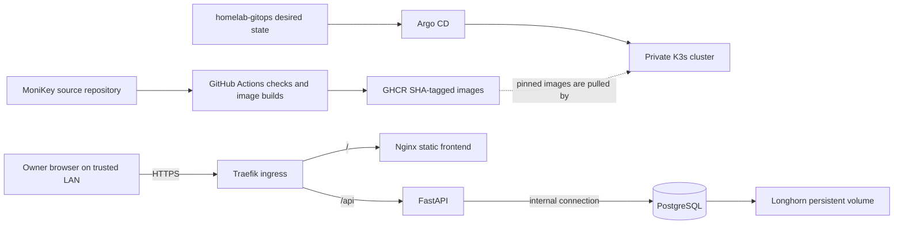

# MoniKey portfolio overview

This page is a sanitized product walkthrough and architecture summary. It uses no live account information. The screenshots in the project README come from the fictional mock ledger in `frontend/src/mockData.ts`.

## Walkthrough

1. **Overview:** Shows net position, monthly income and expenses, recent activity, and credit-card balances. Net position is money across cash, bank, and e-wallet accounts minus card debt.
2. **Accounts:** Separates money available from credit-card debt. Card limits show available credit, which is not counted as cash. Account editing changes the name, opening balance or debt, and card limit while leaving account type fixed.
3. **Activity:** Lists dated income, expenses, purchases, and card payments. A card purchase is a categorized expense. A card payment reduces the source account and card debt but is not recorded as another expense.
4. **Quick entry:** The owner can add income, an expense, or a card payment; entries can be edited or deleted after confirmation.

## System diagram

The frontend also includes an in-memory mock source for local previews. In the deployed system, the browser uses same-origin `/api` requests through the private ingress. PostgreSQL has no public Service or ingress.

## Current deployment

- The private homelab runs a single-node K3s cluster managed by Argo CD.
- Frontend and API images are pinned by full commit SHA. PostgreSQL uses one StatefulSet replica and a Longhorn-backed PVC.
- Runtime credentials are held in a Kubernetes Secret outside Git.
- The self-signed HTTPS certificate may need to be trusted by the owner’s browser.

See the [GitOps deployment runbook](https://github.com/Jeysibn/homelab-gitops/blob/main/docs/MoniKey-Runbook.md) for setup, verification, backup/restore, and rollback commands.

## Known limits

- MoniKey v1 has no authentication. Only use the writable instance on a trusted private network; it is not a public demo.
- The one-node cluster and one PostgreSQL replica do not provide high availability.
- Logical backups are manual. Off-cluster backup retention and disaster recovery have not been verified.
- The full interactive React/API browser journey, automated browser coverage, real-device checks, and screen-reader checks remain unverified.
- v1 does not include banking integrations, recurring bills, investments, or regular transfers.

## Privacy note

The included screenshots use fictional sample values. No live database data is included in portfolio material, screenshots, examples, or tests.
