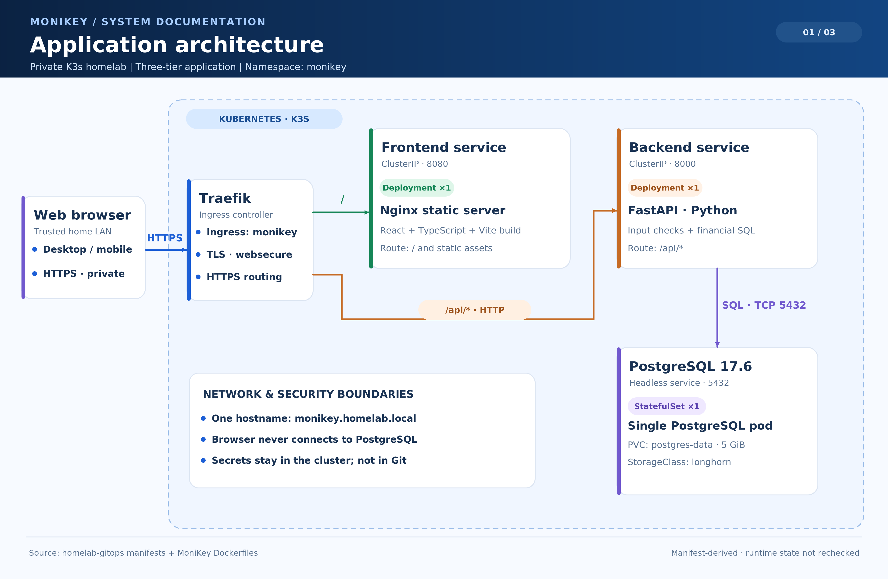

# MoniKey portfolio overview

This page is a sanitized product walkthrough and architecture summary. It uses no live account information. The screenshots in the project README come from the fictional mock ledger in `frontend/src/mockData.ts`.

## Walkthrough

1. **Overview:** Shows net position, monthly income and expenses, recent activity, and credit-card balances. Net position is money across cash, bank, and e-wallet accounts minus card debt.
2. **Accounts:** Separates money available from credit-card debt. Card limits show available credit, which is not counted as cash. Account editing changes the name, opening balance or debt, and card limit while leaving account type fixed.
3. **Activity:** Lists dated income, expenses, purchases, and card payments. A card purchase is a categorized expense. A card payment reduces the source account and card debt but is not recorded as another expense.
4. **Quick entry:** Add income, an expense, a card payment, or a liquid-account transfer; entries can be edited or deleted after confirmation. Custom income and expense categories are managed separately, and an expense category's suggested Kakeibo envelope can be overridden for each transaction.
5. **Kakeibo:** Plan monthly limits across Needs, Wants, Culture, and Unexpected, review actual expense totals, classify previously unclassified expenses, and write weekly/monthly reflections.

## Architecture diagrams

### Application architecture

[Open scalable SVG](../architecture/01-monikey-application.svg).

The frontend also includes an in-memory mock source for local previews. In the deployed system, the browser uses same-origin `/api` requests through the private ingress. PostgreSQL has no public Service or ingress.

The companion [CI/CD and GitOps diagram](../architecture/02-monikey-gitops.png) is a historical overview; see the [learning guide](../LEARNING_GUIDE.md#stage-4-deliver-changes-with-git-github-and-gitops) and GitOps runbook for current workflow details. The [database schema image](../architecture/03-monikey-database-erd.png) is an early four-table snapshot, not the current schema. Current table and migration information is in [`database/README.md`](../../database/README.md).

## Deployment architecture (not live status)

The repository-defined target is a private, single-node k3s cluster managed by Argo CD. The latest source SHA and live cluster image have not been verified as deployed; the owner reports the release is on hold for internet connectivity.
- Frontend and API images are pinned by full commit SHA. PostgreSQL uses one StatefulSet replica and a Longhorn-backed PVC.
- Runtime credentials are held in a Kubernetes Secret outside Git.
- The self-signed HTTPS certificate may need to be trusted by the owner’s browser.

See the [GitOps deployment runbook](https://github.com/Jeysibn/homelab-gitops/blob/main/docs/MoniKey-Runbook.md) for setup, verification, backup/restore, and rollback commands.

## Known limits

- MoniKey v1 has no authentication. Only use the writable instance on a trusted private network; it is not a public demo.
- The one-node cluster and one PostgreSQL replica do not provide high availability.
- The owner reports an automated database backup is configured in the GitOps repository. Off-cluster retention and disaster recovery have not been verified.
- Playwright browser tests and automated Axe checks exist in the application repository. Manual screen-reader and physical-device acceptance remains separate and is not claimed here.
- The latest MoniKey main SHA is not confirmed deployed. The owner reports the release is on hold because of homelab internet connectivity; do not treat this portfolio walkthrough as production-state evidence.
- v1 does not include banking integrations, recurring bills, or investments. Transfers are supported between cash, bank, and e-wallet accounts; credit-card payments remain separate.

## Privacy note

The included screenshots use fictional sample values. No live database data is included in portfolio material, screenshots, examples, or tests.
