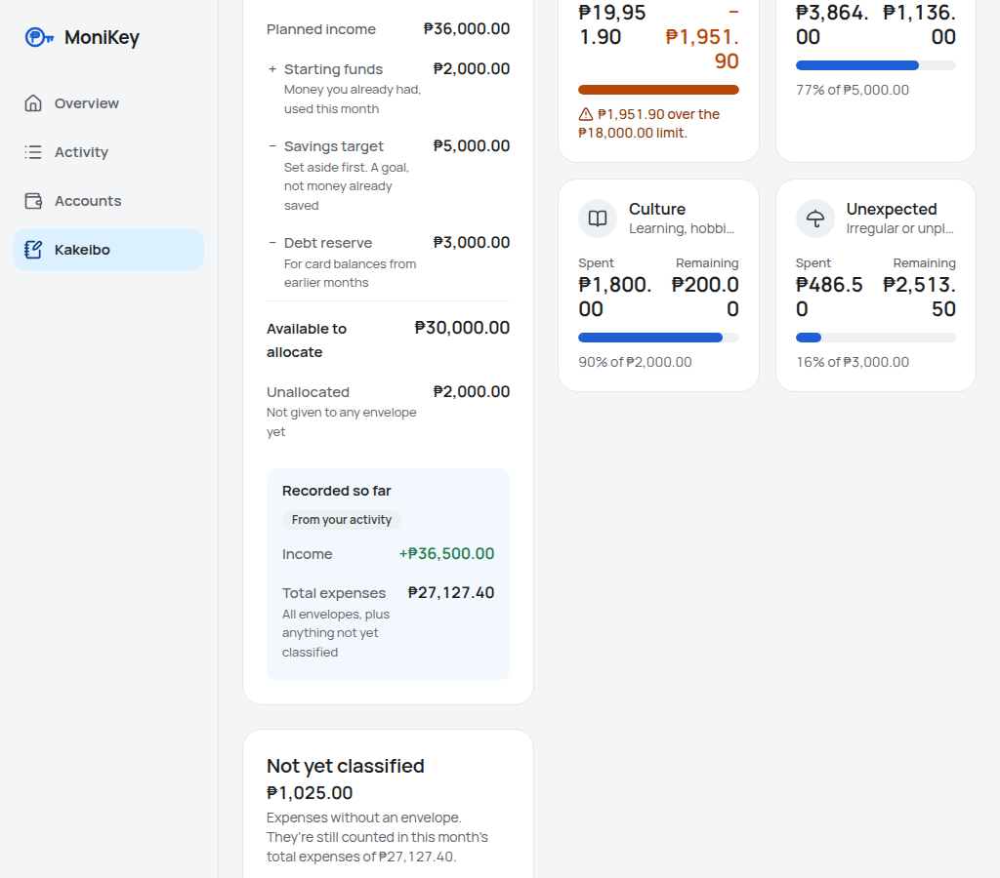
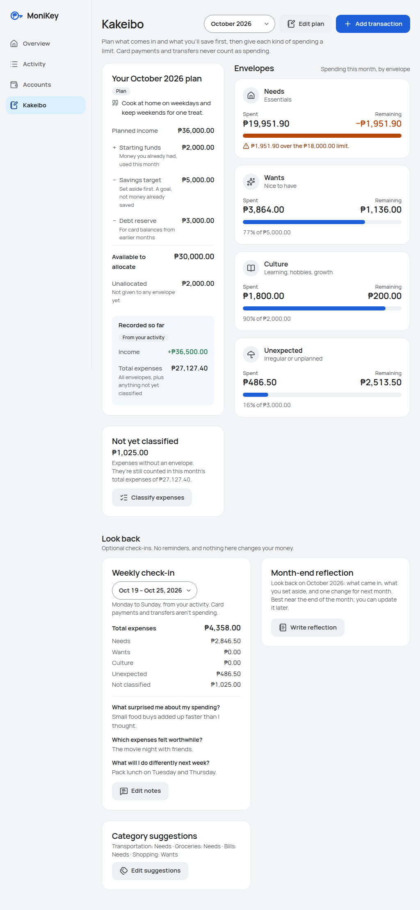
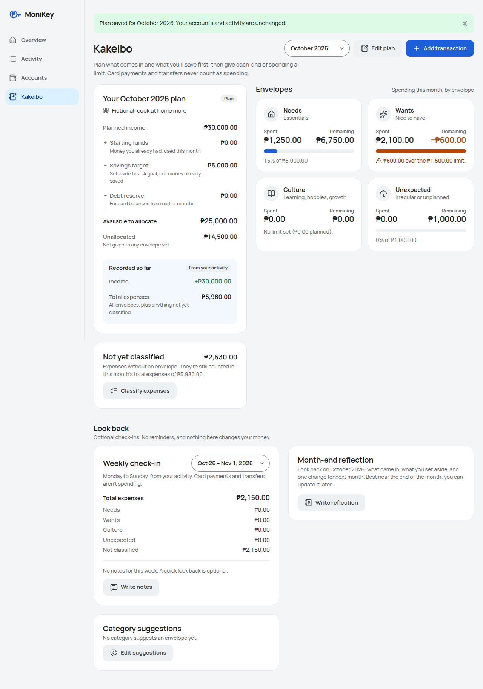
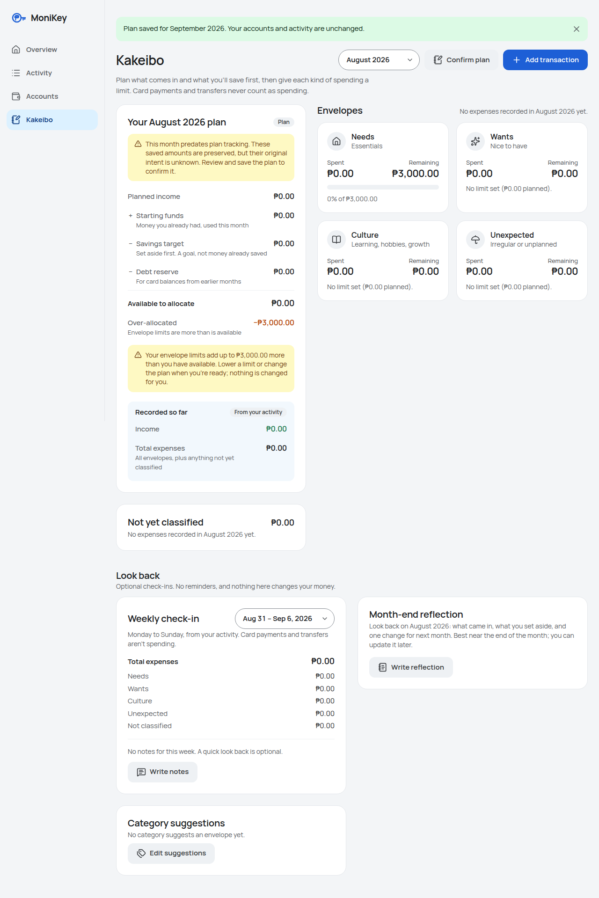
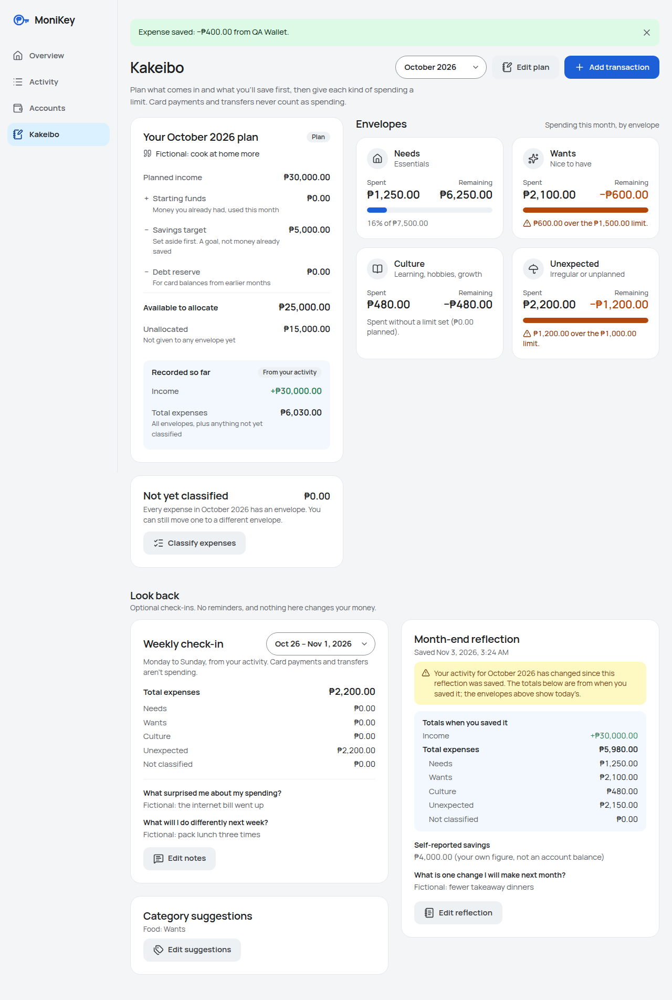
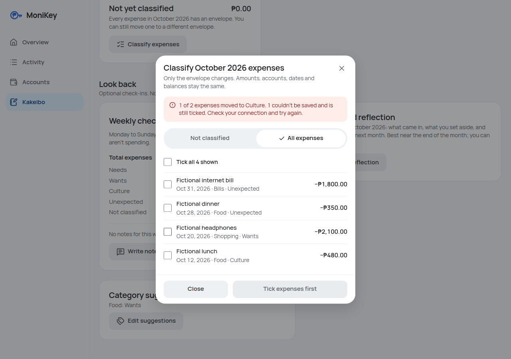

# Kakeibo browser acceptance

> Historical Kakeibo acceptance record (2026-11-03). It documents only the flows and code tested at that time. Current category and Quick Add acceptance lives in [`frontend/browser-tests/`](../../frontend/browser-tests/README.md); latest release status is in the [roadmap](../architecture/ROADMAP.md#current-source-and-release-status).

Interactive browser acceptance for the integrated MoniKey frontend, including Kakeibo (PRs A–E and #7). This is a
test record, not a deployment approval. No live database, homelab service, Kubernetes resource, Argo CD application
or GitOps file was read or changed. Every record shown or written was fictional.

## What was tested

| | |
| --- | --- |
| Integration commit | `58b450721caf15efecc0f5b249e6f059329c7d82` (`origin/feat/card-artwork-discovery`, merge of #7) |
| Test branch | `test/kakeibo-browser-acceptance` (two layout fixes, script updates, this report) |
| Date | 2026-11-03 (app "today" in Asia/Manila: November 2026) |
| Browser | Chrome for Testing 156.0.8078.4 (Chromium), headless, from the existing Playwright cache; `playwright-core` resolved by `frontend/scripts/browser-runtime.cjs`. Nothing was installed. |
| OS | Linux 6.6 (WSL2), Node 24.22.1, Docker Compose 5.6.1 |
| Mock target | `npx vite preview --host 127.0.0.1 --port 4191` serving `npm run build` (mock data source) |
| Real-API target | Disposable Compose project `monikey-qa-browser` on `127.0.0.1:18491` (see below) |
| Not tested | Firefox, Safari/WebKit, real phones and tablets, an operated screen reader |

## Results

### Existing mock-data suites

Run from `frontend/` with `BASE_URL=http://127.0.0.1:4191/`.

| Suite | At the integration head (`58b4507`) | Final (this branch) |
| --- | --- | --- |
| `verify-overview.cjs` | 202/202 | 202/202 |
| `verify-accounts.cjs` | 188/188 | 188/188 |
| `verify-account.cjs` | 28/32 (2 sections aborted) | 47/47 |
| `verify-activity.cjs` | 64/64 | 64/64 |
| `verify-edit.cjs` | 55/57 | 57/57 |
| `verify-quickadd.cjs` | 68/71 (1 section aborted) | 83/83 |
| `verify-states.cjs` | 68/71 | 71/71 |
| `verify-kakeibo.cjs` | 108/108 | 118/118 (new 1024/1280px checks; 117/118 against `58b4507`) |
| `verify-reflections.cjs` | 98/100 | 103/103 (adds 1024px) |
| `audit-a11y.cjs` | 223 passed, 23 findings | 261 passed, 15 findings (now includes Kakeibo) |

Higher totals in the final column are checks that previously never ran because a section aborted, plus the
added widths and views.

#### Why the existing scripts failed, and what changed

None of the old failures were product defects; each one was confirmed in the browser before its script changed.

- **Accounts opens on the wallet card deck** (since `496d03a`, wallet gallery). `verify-account`, `verify-edit` and
  `verify-quickadd` read the List layout ("Cash on hand Cash ₱2,230.00", "Pay card, Blue Card", "Add credit card").
  Their `nav()` helper now selects **List** after opening Accounts. Balances shown were already correct.
- **Add-account failure copy** changed in `0883049` to "Your account details are still here." `verify-account` now
  expects it.
- **Overview loads the accounts for its wallet deck** on its own, so `?demo=load-error` shows five failure blocks, not
  four. `verify-states` expects five; retrying the cards may already restore the deck.
- **PR #7 (migration 006)**: a reflection-only month no longer stores ₱0.00 plan amounts. Two `verify-reflections`
  checks still expected the old "No plan amounts" wording; they now expect "No plan for October 2026 yet".
- **Audit false positive**: "₱21,050.00 owed" was reported as wrapping at every width. The amount and the smaller
  "owed" word share a line with different line-box tops. The check now reports a wrap only when one line box is
  wholly below another; a deliberately narrow test element still trips it.
- **Audit worst-case step** clicked "Add credit card", which only exists in the List layout; it now selects List first.

### New acceptance scripts

| Script | Target | Result |
| --- | --- | --- |
| `verify-acceptance-layout.cjs` | Mock, 320 / 375 / 768 / 1024 / 1440px | 585/585 |
| `verify-real-api.cjs` | Disposable real stack (React → Nginx → FastAPI → PostgreSQL 17.6, migrations through 006) | 109/109 |

`verify-acceptance-layout.cjs` checks the four views and seven dialogs (Quick Add, plan, weekly notes, month-end
reflection, classify, category suggestions, add account) at each width:

- **Every view and dialog:** no horizontal scroll, no clipped text, no overlapping or off-screen controls, and
  controls at least 44px tall on phones.
- **Navigation:** exactly one main navigation, reaching all four views (and Add transaction on phones), with the
  current page marked. On phones the bottom bar is pinned and the end of the page scrolls clear of it.
- **Dialogs:** each fits the screen with its footer visible, and a long body scrolls inside the dialog. 60
  Tab/Shift+Tab presses never leave it, the focused control has a visible indicator, Escape closes it, and focus
  returns outside it.

Overlap checks skip fixed bars and deliberately positioned layers: the wallet deck stacks cards, and each card has a
corner menu over its details button.

`verify-real-api.cjs` drives the real application in the browser and reads the API to confirm each result. See
[Real API browser integration](#real-api-browser-integration).

## Confirmed regressions and fixes

Both were introduced with the Kakeibo dashboard (PRs C/D) and were not caught because the earlier suites skipped
1024px and did not audit Kakeibo.

| # | Severity | Problem | Fix | Regression check |
| --- | --- | --- | --- | --- |
| R1 | Serious: amounts misread | From 1024 to 1279px, the envelopes share 7 of 12 columns beside the plan; two cards per row left about 205px each and amounts broke mid-number ("₱19,95 / 1.90", "−₱1,951. / 90"). | `KakeiboView.tsx`: envelopes stack in one column from `lg` and return to two from `xl` (1280px). The loading skeleton matches. | `verify-kakeibo.cjs` "every envelope amount stays on one line" at 768/1024/1280/1440 (fails on `58b4507`); `audit-a11y.cjs` Kakeibo width sweep |
| R2 | Moderate: WCAG 1.4.4 | At 375px with text at 200%, Kakeibo scrolled sideways: the card buttons cannot wrap (`whitespace-nowrap`) and the week/month total rows could not shrink. | Kakeibo card actions (Classify expenses, Write/Edit notes, Write/Edit reflection, Edit suggestions) may wrap; totals rows wrap the amount under its label only when it does not fit. | `audit-a11y.cjs` "Kakeibo: text at 200%" (fails on `58b4507`) |

Before and after R1, mock data at 1024px:




A sweep at 1024, 1100, 1180, 1279, 1280, 1366 and 1440px, with the default, `huge` and `many` demos, found no wrapped
amount and no horizontal scroll after the fix.

## Responsive findings

Widths 320, 375, 768, 1024 and 1440px (plus 360, 414, 1280 and 1920px in the audit):

- No horizontal scrolling on any view or dialog; 320px also reflows (equivalent to 400% zoom).
- Phones show the five-column bottom bar (Overview, Activity, Accounts, Kakeibo, Add); 768px shows the rail and
  1024px+ the sidebar. The bottom bar never hides the last content or a focused control.
- Dialogs become bottom sheets on phones and centred dialogs from 768px. Save/Cancel stay visible, and long bodies
  (plan, reflection, classify) scroll inside the sheet.
- Peso amounts stay on one line in envelopes, totals and accounts at every tested width (after R1).
- Kakeibo keeps the plan and envelopes before the "Look back" cards at every width.
- Minor, deliberate: long classify-row details truncate with an ellipsis at 375px ("Other · Not classifi…"); the full
  row text is the checkbox label.

Mock screenshots: [Kakeibo at 375px](screenshots/kakeibo-acceptance/mock-kakeibo-375.png) and
[the reflection sheet at 375px](screenshots/kakeibo-acceptance/mock-reflection-dialog-375.png).

## Kakeibo behaviour

Coverage combines the mock suites (fixed fictional October 2026 data) and the real-API run (fictional "QA …" and
"Fictional …" records). "Real" means verified in the browser against the real API.

| Area | Result | Where |
| --- | --- | --- |
| Open from navigation; switch months | Pass | Real, mock |
| Month with no plan (`not_saved`, `plan: null`) | Pass: "No plan for November 2026 yet", Create plan | Real |
| Create, reload, edit and reload a plan | Pass: persisted, form reopens with saved values | Real |
| Explicit all-zero plan (`saved`) | Pass: reads as a plan, Edit plan, finite progress values, no NaN/Infinity | Real |
| `legacy_unknown` (August row with `plan_presence` set to NULL in the disposable DB) | Pass: notice "predates plan tracking", preserved amounts, **Confirm plan**; confirming saves it as `saved` | Real |
| Reflection-only month never looks like a budget | Pass: still `not_saved`, `plan: null`, Create plan | Real |
| Planned vs actual income shown separately; savings target called a goal | Pass | Real, mock |
| Four envelope limits, spending, negative remaining ("−₱600.00", "₱600.00 over the ₱1,500.00 limit") | Pass | Real, mock |
| ₱0.00 limit with no spending | Pass: "No limit set (₱0.00 planned)", no broken bar | Real |
| Unclassified spending | Pass: ₱2,630.00 from the server, payment and transfer excluded | Real |
| Loading and API-error states, Retry | Pass | Mock (`?demo=loading`, `load-error`, `failing=kakeibo,…`) |

## Quick Add and classification

| Area | Result | Where |
| --- | --- | --- |
| Cash expense, income, card purchase, card payment, transfer | Pass: all saved through the UI; the API shows the right records and balances (wallet −₱205.00 net, card debt +₱300.00 net) | Real |
| Envelope choice only for expenses | Pass: no envelope control for income, payment or transfer | Real |
| All five choices: Needs, Wants, Culture, Unexpected, Not sure yet (null) | Pass: stored as `needs`/`wants`/`culture`/`unexpected`/`null` | Real |
| Category suggestion (Food → Wants) preselects in Quick Add | Pass | Real, mock |
| A deliberate choice survives a later category change | Pass: Culture kept after switching Food → Groceries, and saved | Real, mock |
| Changing a suggestion leaves saved expenses alone | Pass | Real, mock |
| Edit an expense; delete an expense with confirmation | Pass: persisted after reload; the edit kept the expense's envelope | Real, mock |
| Classify one; classify several; clear; explicit confirmation | Pass | Real, mock |
| Partial failure | Pass: one of two ticked expenses was deleted on the server first; "1 of 2 expenses moved to Culture. 1 couldn't be saved and is still ticked." | Real (genuine 404), mock (`?demo=partial`) |
| Incomplete-list warning | Pass: July holds 1,005 expenses; "Showing the latest 200 … More may exist", then after four Load more, "This list stops at the latest 1,000 entries … Older ones may still need an envelope." | Real |
| Income, transfers, card payments never listed | Pass | Real, mock |
| Classification changes nothing else | Pass: amount, account, category, date and note unchanged for every October expense; card debt and bank balance unchanged by plans, suggestions, classifications and reflections | Real |

## Reflections

| Area | Result | Where |
| --- | --- | --- |
| Monday–Sunday weeks, newest first, no future weeks | Pass: Oct 26 – Nov 1, …, Sep 28 – Oct 4 | Real, mock |
| Week crossing a month boundary | Pass: Oct 26 – Nov 1 totals ₱2,150.00, excluding the payment and transfer | Real |
| Week crossing a year boundary | Pass: January 2026 offers "Dec 29, 2025 – Jan 4, 2026", totalling ₱350.00 across both years; notes saved under 2025-12-29 | Real |
| Save all three answers; reload; edit; clear one on purpose | Pass: the API stores the cleared answer as `null`, keeps the untouched one, updates the edited one | Real, mock |
| Failed weekly save keeps the input | Pass: PUT aborted in the browser; notice shown, all answers kept, retry saves | Real, mock |
| Form keeps the week it was opened for | Pass by design: the dialog is modal, and `WeeklyReview` captures the week at open | Mock, code review |
| Monthly reflection without a plan; zero self-reported savings; blank answers | Pass: `actual_saved_declared` `0.00`, blank answers `null`, month still `not_saved` | Real |
| Monthly reflection with a plan | Pass: plan untouched (`saved`, needs ₱7,500.00) | Real |
| Server snapshot shown | Pass: "Totals when you saved it" equals the API snapshot; the browser computes no snapshot | Real, mock |
| Ledger edit after the review | Pass: `actuals_changed_since_review: true`, warning shown, stored snapshot unchanged | Real, mock |
| Only an explicit Save refreshes the snapshot | Pass: after Save the snapshot total rose by exactly ₱50.00 and the warning cleared | Real, mock |
| Failed monthly save keeps the input | Pass: "What you wrote is still here.", answers kept, nothing stored | Real |






## Real API browser integration

The stack was the repository's own `docker-compose.yml` under a unique project name, with an override that changes
only the published port. Nothing was committed for it.

```yaml
# qa-compose-override.yml (kept outside the repository)
services:
  frontend:
    ports: !override
      - "127.0.0.1:18491:8080"
```

```bash
export MONIKEY_DB_PASSWORD=qa-placeholder-not-a-secret   # placeholder; no .env exists
C="docker compose -p monikey-qa-browser --project-directory . -f docker-compose.yml -f qa-compose-override.yml"
sg docker -c "$C up -d --build --wait"
sg docker -c "docker port monikey-qa-browser-frontend-1"   # must print 8080/tcp -> 127.0.0.1:18491
cd frontend
QA_BASE_URL=http://127.0.0.1:18491/ node scripts/verify-real-api.cjs seed
sg docker -c "docker exec monikey-qa-browser-db-1 psql -U monikey_app -d monikey_dev -c \"UPDATE kakeibo_month_plans SET plan_presence = NULL WHERE month = DATE '2026-08-01'\""
QA_BASE_URL=http://127.0.0.1:18491/ node scripts/verify-real-api.cjs browser
sg docker -c "$C down --volumes"   # only after confirming the project's sole volume is monikey-qa-browser_postgres_data
```

- **Isolation:** before any write, the containers, the volume (`monikey-qa-browser_postgres_data`) and the port
  mapping were confirmed to belong to this project. Another project's containers were present and were not touched.
- **Fresh data:** initialization ran `001_init`, the seed and the fresh forms of 004–006; `plan_presence` existed. The
  stack was recreated from an empty volume for each run.
- **Built from the final code:** the final run (109/109) used a frontend image built from this branch.
- **Script safety:** `verify-real-api.cjs` refuses any base URL other than `http://127.0.0.1:<port>/`, refuses port
  8080, refuses to seed unless the database has no accounts (verified: exit codes 2 and 3), and fetches with
  `redirect: "error"`.
- **Failure handling:** deliberate failures (two aborted PUTs and the PATCH to the deleted expense) are excluded by
  rule. Any other HTTP status of 400 or more, failed request, console error or warning, or request to another
  origin fails the run. There were none.
- **Persistence:** plans, plan edits, notes, reflections, classifications, edits and deletes were each confirmed by a
  page reload or an API read.

The final run left the database holding only fictional data, and the stack was then removed.

## Accessibility

Automated (Chromium only):

- **`audit-a11y.cjs`, now including Kakeibo:**
  - Rendered text contrast (WCAG AA) on every view, including failure states.
  - Accessible names and landmarks.
  - Tab stops have a visible focus indicator, and none sit under the bottom bar.
  - Dialog behaviour.
  - 320px reflow, 200% text and reduced motion.
  - Colour vision and forced colours.
  - A keyboard-only journey and worst-case content.

  Result: 261 checks passed, 15 findings (below).
- **`verify-acceptance-layout.cjs`:** focus trapping in seven dialogs at five widths, Escape, return focus, focus
  indicators, and 44px targets on phones.
- **`verify-kakeibo.cjs` and `verify-reflections.cjs`:**
  - Focus starts on the first field and moves to the error summary on invalid submit.
  - Escape returns focus to the opener, and the h1 is focused on view change.
  - Labelled fields and live status messages.
  - No animation under `prefers-reduced-motion: reduce`.

No automated rules engine (axe-core or similar) is installed, and none was added. **No screen reader was operated.**

### Remaining findings (inherited, not release-blocking)

| Finding | Severity | Origin | Assessment |
| --- | --- | --- | --- |
| Wallet card labels below 12px: "Balance" (11–11.9px), "Below zero" (10px) and "N% used" (11px), Overview and Accounts | Moderate (audit lists the worst-case versions as serious) | Wallet gallery, before Kakeibo | Contrast passes and WCAG sets no minimum size. "Below zero" carries a status, so a follow-up should raise these labels to at least 12px. Left unchanged here as a visual-design decision outside this test scope. |

## Manual checks still required

Screen reader (VoiceOver on iOS/macOS Safari, and NVDA with Firefox or Chrome on Windows):

1. Navigate by landmarks and headings: one `main`, a `Main` navigation, h1 per view, and h2 for "Envelopes" and "Look back".
2. Each envelope card announces its name, spent, remaining (including "minus" for negatives) and the over-limit sentence.
3. The plan card announces "Savings target … A goal, not money already saved".
4. The `legacy_unknown` notice is read, and the button is announced as "Confirm the August 2026 plan".
5. Opening each Kakeibo dialog announces its title. Focus lands on the first field and stays in the dialog, and
   closing returns focus to the opener.
6. Invalid plan submit: the error summary is announced and each field error is tied to its field.
7. Save confirmations ("Plan saved for …", "1 expense moved to Needs. Balances and totals are unchanged.") are read
   once from the polite status region.
8. Classify: the "Not classified / All expenses" choice, each checkbox (name, date, category, amount), the progress
   while saving, and the partial-failure message.
9. Weekly select: week labels read as dates ("Oct 26 – Nov 1, 2026").
10. The month-end "has changed since this reflection was saved" warning is reachable and read before the snapshot.
11. Peso amounts read naturally (₱ and the minus sign) in the voice and language you use.

Other manual checks:

- Real phones (iOS Safari, Android Chrome): bottom bar with safe-area insets, sheets with the on-screen keyboard open,
  date and select pickers, wallet deck gestures.
- Firefox and Safari engines, and browser page zoom at 200–400% (the audit uses text-size and width equivalents).
- After a separately approved migration: an owner review of any real `legacy_unknown` months, and the runbook smoke
  checks against the homelab.

## Release prerequisites still open

Unchanged from `docs/operations/KAKEIBO_RELEASE_RUNBOOK.md`: a verified live backup with an off-cluster copy and a
tested restore; a schema inspection to choose the missing migrations; the owner's deployment approval; and the
post-rollout smoke checks. This acceptance run does not satisfy any of them.

## Readiness assessment

**READY FOR RELEASE REVIEW (frontend browser acceptance).** Every mock suite and both new acceptance scripts pass in
Chromium. The real-API browser journey (109 checks) confirms the plan-presence contract, classification, reflections,
snapshots and unchanged balances against PostgreSQL with migrations through 006. The two layout regressions found are
fixed and covered by checks. The remaining items are inherited and moderate, or need a person: screen readers, real
devices and other browser engines. This is not deployment approval; the release prerequisites above remain.

## Artifacts

- Committed screenshots (fictional data only): `docs/quality/screenshots/kakeibo-acceptance/` (8 images, about 1.6 MB).
- Full run logs, JSON results and every screenshot were kept outside the repository in the test session's scratch
  directory, which also held the Compose override. No browser profile, secret or real financial data was committed.
